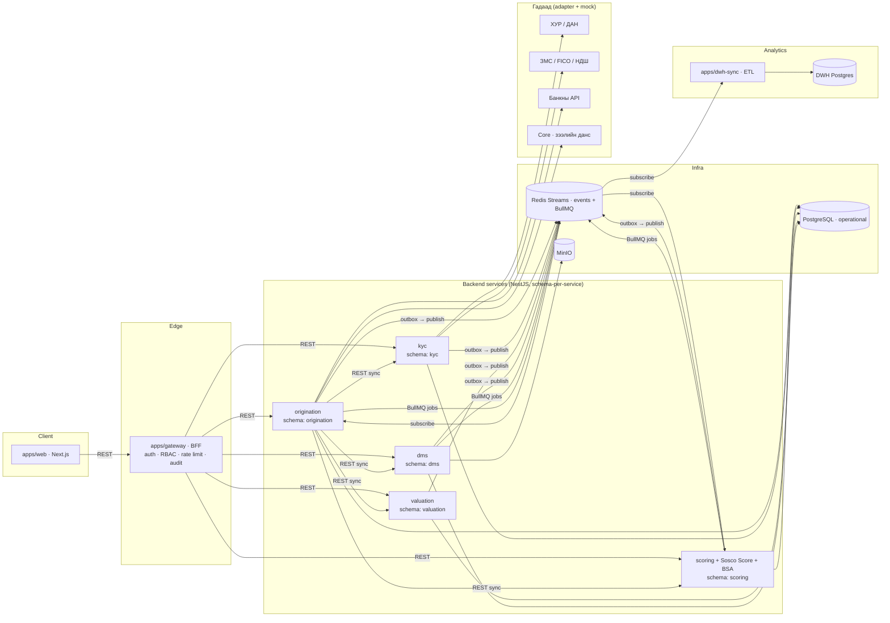

# LOS Radix — Claude Code-ийн үндсэн заавар (Enterprise, Turborepo)

Монголын ББСБ-д зориулсан, олон дэд системээс бүрдсэн зээлийн олголтын систем. Шаардлага `docs/`-д; **код бичихээсээ өмнө `docs/` бүхлээр нь унш.** Энэ файл нь архитектур, харилцааны дүрэм, ажиллах журам.

## 1. Баримтууд
| Файл | Агуулга |
| --- | --- |
| `docs/01-los-requirements.md` | 12 модуль, төлвийн мөчлөг, процесс, FR-1…FR-14, BR-1…BR-13, NFR, шийдвэрүүд |
| `docs/02-bsa-requirements.md` | BSA: дэлгэц, 7 алхам, ангилал/DTI, 8 дохио, INT-1…10 |
| `docs/03-data-model.md` | Enum, хүснэгт, талбар (§5-д сервис бүрт хуваарилсан) |
| `docs/04-build-plan.md` | Модуль 0–14 дараалал, acceptance criteria |
| `docs/DECISIONS.md` | Таамгийн бүртгэл — тодорхойгүй зүйл дээр энд бичээд үргэлжлүүл |

## 2. Архитектурын зураглал



### 2.1 apps/ (8)
| App | Port | Үүрэг | DB schema | docs/01 модуль |
| --- | --- | --- | --- | --- |
| `web` | 3000 | Next.js UI — бүх дэлгэц; зөвхөн gateway руу дуудна | — | UI бүгд |
| `gateway` | 4000 | BFF: JWT/OIDC, RBAC, салбарын хязгаарлалт, rate limit, аудит, OpenAPI нэгтгэл | `iam` | NFR-3 |
| `origination` | 4001 | Хүсэлт, төлвийн машин, зээлдэгч, орлого, нөхцөл, ЭТХ, батлах урсгал, гэрээ, олголт, хар жагсаалт, мэдэгдэл, тайлан, тохиргоо | `origination` | 1, 2, 3, 4, 6, 8, 9, 11, 12 |
| `kyc` | 4002 | ХУР/ДАН, ЗМС, FICO, НДШ, хар жагсаалт тулгалт, PEP/AML, лавлагааны хуучралт | `kyc` | 1 (KYC), 2 |
| `scoring` | 4003 | Тооцоолол engine (A/B/C, ӨОХ/ӨТЧХ/LTV, stress), **Sosco Score (дотоод)**, **BSA** бүхэлдээ | `scoring` | 7, 10 |
| `valuation` | 4004 | Барьцааны үнэлгээ: суурь үнэ, арга, haircut, гадны үнэлгээ, дахин үнэлгээ | `valuation` | 5 (FR-14) |
| `dms` | 4005 | Файл сан, checklist, гэрээний загвар docx→PDF, албан бичиг, retention | `dms` | 9, 11 (файл) |
| `dwh-sync` | 4006 | Event + CDC → DWH; operational DB руу хэзээ ч бичихгүй | DWH (тусдаа) | — |

### 2.2 packages/ (5)
| Package | Агуулга | Дүрэм |
| --- | --- | --- |
| `@los/contracts` | Enum, DTO (zod), event схем, OpenAPI клиент | Сервис хоорондын **цорын ганц** гэрээ; enum-ийг өөр газар давтахгүй |
| `@los/calc` | ЭТХ, A/B/C, ӨОХ/ӨТЧХ/LTV, DTI, haircut, Sosco Score — цэвэр функц | I/O байхгүй, 100% coverage заавал; UI-д тооцоолол хийхгүй |
| `@los/database` | Prisma helper, pgcrypto wrapper, outbox, Redis event bus, schema init SQL, DWH view | **Сервисийн модель энд биш** — `apps/<svc>/prisma/` |
| `@los/ui` | Ant Design дээрх design system, WizardLayout, DataTable, `mn.json` | web л ашиглана |
| `@los/config` | tsconfig, eslint, vitest preset, Dockerfile template | бүгд |

## 3. Дэд систем хоорондын харилцааны дүрэм

### 3.1 Хоёр суваг — зориулалт тодорхой
| Суваг | Хэзээ | Механизм | Жишээ |
| --- | --- | --- | --- |
| **Sync REST** | Хэрэглэгч хариуг хүлээж байх үед; үр дүн нь дараагийн UI алхамд шууд хэрэгтэй | HTTP/JSON, OpenAPI; DTO `@los/contracts`-аас; timeout 15с (гадаад), 3с (дотоод); retry зөвхөн idempotent GET | origination → kyc `POST /inquiry/fetch`; origination → scoring `POST /underwrite`; origination → valuation `POST /valuate` |
| **Async event** | Төлөв өөрчлөлт, урт ажил, олон сервис сонирхох факт | Transactional outbox → Redis Streams (`los:events`), consumer group = сервисийн нэр, at-least-once, idempotency `eventId` | `ApplicationSubmitted`, `StatementImported`, `ValuationCompleted` → dwh-sync бүгдийг, origination `ScoringCompleted`-ийг |
| **Job queue** | Нэг сервис доторх урт ажил | BullMQ (Redis) | BSA импорт, PDF үүсгэх, retention, ноорог архивлах |

### 3.2 Хатуу дүрэм
1. `web` → зөвхөн `gateway`. Сервис рүү шууд дуудахгүй.
2. Сервис хоорондын sync дуудлага зөвхөн `origination → {kyc, scoring, valuation, dms}` чиглэлтэй. Бусад сервис бие биенээ sync дуудахгүй; хэрэгтэй бол event.
3. **Cross-schema FK хориотой.** Өөр сервисийн entity-г `string id`-аар хадгална; хэрэгтэй бол өөрийн schema-д projection (read model) хийж event-ээр шинэчилнэ.
4. Event-ийг бизнес транзакцтай **нэг транзакцид outbox-д** бичнэ; relay worker нийтэлнэ. Шууд publish хийхгүй.
5. Event бүр `@los/contracts/events.ts`-д zod схемтэй, `version` талбартай. Breaking change → шинэ version, хуучныг 1 release хадгална.
6. Consumer idempotent: `processed_events(eventId)` хүснэгтээр давхардлыг хаана.
7. Гадаад интеграци (ХУР, ДАН, ЗМС, FICO, НДШ, банкны данс, Core) — зөвхөн эзэмшигч сервисийн `integrations/<name>/` дотор `interface` + `MockXxx` + `RealXxx`; `INTEGRATION_MODE` env-ээр солино. Mock deterministic fixture буцаана.
8. Нийтлэг өгөгдөл (бүтээгдэхүүн, босго, тохиргоо) эзэмшигч нь `origination.settings`; бусад сервис `SettingsChanged` event-ээр projection авна, эсвэл sync GET (cache 60с).
9. Авторизаци gateway-д шийдэгдэнэ; сервисүүд `X-User-Id`, `X-Roles`, `X-Branch-Id`, `X-Correlation-Id` толгойд итгэнэ (дотоод сүлжээ, mTLS үйлдвэрлэлд).
10. Бүх хүсэлт/event `correlationId` дамжуулна; лог JSON, `correlationId`-тай.

### 3.3 Event каталог (эхлэл — `packages/contracts/src/events.ts`)
| Event | Гаргагч | Сонсогч | Утга |
| --- | --- | --- | --- |
| ApplicationSubmitted | origination | scoring, dwh | 7/7 бүрдэж илгээсэн |
| ApplicationStatusChanged | origination | dwh, dms | төлвийн бүх шилжилт |
| ApplicationApproved | origination | dms (гэрээ үүсгэх), dwh | бүх түвшин зөвшөөрсөн, contractNo үүссэн |
| ApplicationReturned | origination | dwh | буцаасан |
| DisbursementApproved | origination | dwh | Core-д данс нээгдсэн |
| KycCompleted | kyc | origination, dwh | лавлагаа бүрэн, blacklisted эсэх |
| StatementImported | scoring | origination (алхам төлөв), dwh | BSA импорт дууссан/алдаа |
| ScoringCompleted | scoring | origination, dwh | арга, DTI, Sosco Score |
| ValuationCompleted | valuation | origination (LTV), dwh | үнэлгээ бэлэн |
| DocumentUploaded | dms | origination (checklist), dwh | файл орсон |

## 4. Өгөгдлийн хуваарилалт (docs/03 → сервис)
| Сервис | Хүснэгтүүд |
| --- | --- |
| gateway (`iam`) | org, branch, user, role, session, audit_log (нэвтрэлт) |
| origination | customer, customer_contact, customer_bank_account, loan_application, _borrower, _step, income_*, product, approval_level(_member), contract_number_template, setting, approval_request, approval_vote, decision_record, contract (meta), official_letter (meta), disbursement_request, repayment_schedule(_row), blacklist, notification, comment, audit_log |
| kyc | inquiry, unregistered_loan, kyc_check, aml_screening |
| scoring | calculation, sosco_model, sosco_result, bsa_analysis, bsa_import_job, bsa_transaction, bsa_category, bsa_rule, bsa_suspicion |
| valuation | collateral (үнэлгээний тал), collateral_valuation, base_price, haircut_rule |
| dms | file, document, contract_template, document_checklist, retention_policy |
| dwh | fact_application, fact_disbursement, fact_bsa_analysis, dim_customer, dim_product, dim_branch, dim_date |

Барьцаа (collateral) нь origination (хүсэлттэй холбоо, KYC, ачаалал, ЭБ) ба valuation (үнэ) хоёрт хуваагдана: origination `collateral` эзэмшинэ, valuation `collateral_valuation`-ийг `collateralId` string-ээр холбоно.

## 5. Технологийн стек
Node 22, pnpm 9, Turborepo 2 · NestJS 10 + Prisma 5 (schema-per-service) · Next.js 15 + React 19 + Ant Design 5 + TanStack Query · PostgreSQL 16 (operational + DWH тусдаа instance) · Redis 7 (Streams + BullMQ) · MinIO · zod · Vitest, Supertest, Playwright · Docker Compose · GitHub Actions. Хэл: UI монгол кирилл (`packages/ui/src/i18n/mn.json`), код/commit англи.

## 6. Ажиллах журам
1. `docs/04-build-plan.md`-ийн дарааллаар **нэг модуль = нэг даалгавар**; дуусаад миграци + тест + AC шалгаад зогс.
2. Шаардлагын ID-г кодонд тэмдэглэ (`// FR-10.2`). BR утгыг hardcode хийхгүй — `setting`/`product`-оос.
3. Шинэ хүснэгт нэмэхдээ §4-ийн хуваарилалтыг мөрд; эргэлзвэл `docs/DECISIONS.md`-д бичээд үргэлжлүүл.
4. Сервис бүрт `GET /api/health`; e2e тест `apps/web/e2e/`.
5. Хувийн мэдээлэл (регистр, данс, ИҮ зураг) `@los/database` encryptedField-ээр; лог-д бичихгүй.
6. Commit: `feat(scoring/bsa): khan parser (BSA-FR-2.1)`; хавтасны нэрээр scope.

## 7. Эхлэх
```
cp .env.example .env
docker compose up -d
pnpm install
pnpm db:generate && pnpm db:migrate && pnpm db:seed
pnpm dev
```
Эхний даалгавар: `docs/04-build-plan.md` Модуль 0 — одоо байгаа scaffold дээр Prisma схемүүдийг §4-өөр бөглөж, outbox/event bus/encrypted helper-ийн TODO-г хэрэгжүүлж, gateway auth + RBAC, seed бичих.
