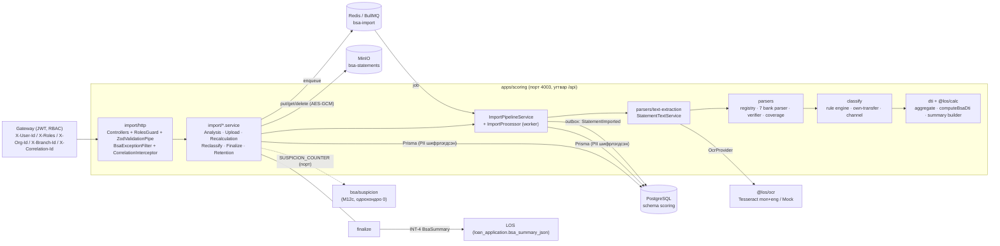
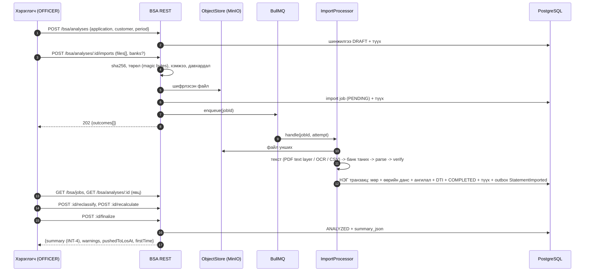

# 05 · Банкны хуулгын шинжилгээ (BSA) ба OCR: хэрэгжүүлэлтийн гарын авлага

Энэ баримт `docs/02-bsa-requirements.md` (шаардлага), `docs/03-data-model.md` (өгөгдлийн загвар) хоёрын дагуу **хийгдсэн зүйлийг**
тайлбарлана: архитектур, өгөгдлийн урсгал, REST API, тохиргоо, шинэ банк нэмэх, parser баталгаажуулах, OCR хэрэглээ, хязгаарлалт.
Шаардлагын код (`BSA-FR-2.2`, `INT-4`, `NFR-3` гэх мэт) нь `docs/02`-ийнх; эх код дээрх `// BSA-FR-…` тайлбартай нэг.

> **ЧУХАЛ: баталгаажаагүй.** Бодит банкны хуулга `samples/`-д ОДООГООР БАЙХГҮЙ. Долоон банкны (Хаан, Голомт, ТДБ, Хас, Капитрон,
> Төрийн банк, М банк) parser бүгд **зохиомол (SYNTHETIC) хуулгаар** л шалгагдсан. Тестүүд «parser бодит хуулгыг зөв уншина» гэсэн
> баталгаа БИШ. Бодит дээжээр баталгаажтал импорт бүр `UNVERIFIED_PARSER` анхааруулгатай дуусна, `BankProfile.verified === false`.
> OCR (зургаас унших) нь Tesseract `mon+eng`-ээр зохиомол зураг дээр турших үед ч тайлбарын текстэд үсэг/тоо андуурсан (`O`↔`0` гэх мэт),
> тиймээс **үр дүнг хүн шалгана** (дэлгэрэнгүй §10).

## 1. Тойм

Нэг шинжилгээ (`bsa_analysis`) = нэг зээлийн хүсэлт × нэг зээлдэгч (хувилбартай, INT-7). Хэрэглэгч хуулгын файл (PDF, PNG/JPG, CSV, текст)
оруулна -> систем банкийг таньж, parse хийж, **үлдэгдлийн гинжээр баталгаажуулж**, гүйлгээг ангилж, ӨОХ-ийг (DTI) тооцоолно ->
хэрэглэгч ангиллыг засч, параметр өөрчилж дахин тооцоолно -> «Системрүү татах» (`finalize`) дээр INT-4 хураангуйг LOS руу буцаана.

Нэг PR-ийн хүрээнд бүтэн «upload -> дүн -> LOS» босоо зүсэлт бэлэн: REST controller, zod DTO шалгалт, in-memory ба бодит Postgres+Redis дээрх
e2e тест, нүцгэн `node dist/main.js` асаалтын туршилт.

| Давхарга | Хаана | Үүрэг |
| --- | --- | --- |
| HTTP | `apps/scoring/src/modules/bsa/import/http/` | 4 controller, `RolesGuard`, `ZodValidationPipe`, алдааны filter, multipart interceptor |
| Application | `.../bsa/import/*.service.ts` | `AnalysisService`, `UploadService`, `ImportPipelineService`, `RecalculationService`, `ReclassifyService`, `FinalizeService`, `RetentionService` |
| Домэйн | `.../bsa/parsers`, `.../bsa/classify`, `.../bsa/dti`, `packages/calc` | parser, verifier, ангилал, DTI (томьёо зөвхөн `@los/calc`-д) |
| Дэд бүтэц | `.../bsa/common` | `PiiCipher`, `ObjectStore` (MinIO), `ImportQueue` (BullMQ/Redis), `DomainEventPublisher` (outbox), `BsaSettingsProvider`, Prisma repository |
| OCR | `packages/ocr`, `.../bsa/parsers/text-extraction` | `OcrProvider` (Mock/Tesseract), `StatementTextService` |
| Гэрээ | `packages/contracts/src/bsa.ts` | REST схем, `BsaSummary` (INT-4), `BsaScoringInput` (INT-5), алдааны хэлбэр |

## 2. Архитектур



Дүрэм: бусад BSA дэд модуль зөвхөн `common/infra.ports.ts` дахь **port + Symbol token**-оос хамаарна (`PII_CIPHER`, `OBJECT_STORE`,
`EVENT_PUBLISHER`, `IMPORT_QUEUE`, `BSA_SETTINGS`; `SUSPICION_COUNTER` нь `import/suspicion.counter.ts`-д, `OCR_PROVIDER` нь `parsers/text-extraction`-д). Adapter солих (жишээ нь өөр queue) нь
`BsaCommonModule` дахь нэг provider.

## 3. Өгөгдлийн урсгал



### 3.1 Нэг импорт ажил (pipeline)

1. Ажил `PROCESSING` болно (дахин оролдлого дээр хадгалсан банкийг дахин ашиглана).
2. Object store-оос уншиж текст гаргана (`extractTimeoutMs` хугацаатай): PDF text layer -> байхгүй бол OCR fallback; зураг -> OCR; CSV/текст.
3. Банк тодорхойлно (`StatementParserRegistry`, оноо `minScore`) эсвэл хэрэглэгчийн заасан банк.
4. Parse -> verify: үлдэгдлийн гинж, мөрийн тоо, огноо, эзэмшигч (нэр/регистр), PDF metadata, QR, OCR итгэл. **Баталгаажуулалт амжихгүй бол мөр хадгалахгүй.**
5. Нэг DB транзакцид: мөр (багцаар `insertChunkRows`), өөрийн данс, ангилал, DTI, ажил `COMPLETED`, түүх, `StatementImported` event (outbox).
6. Хадгалагдсан хураангуй (`summary_json`) `DRAFT` төлөвтэй шинэчлэгдэнэ (тиймээс `GET :id/summary` import-ын дараа 200).

Алдаа:
- **Тодорхой алдаа** (баталгаажуулалт, банк танигдаагүй/нэг бус, нууцлагдсан PDF, мөр хэт олон, `IMPORT_TIMEOUT`, уншигдахгүй зураг...): ажил `FAILED`,
  мөр хадгалагдахгүй, автоматаар дахин оролдохгүй. Хэрэглэгч `POST /bsa/jobs/:id/retry` дууддаг (шаардлагатай бол `bankCode` солино).
- **Түр/гэнэтийн алдаа** (DB, object store, OCR хөдөлгүүр түр унасан/хугацаа хэтэрсэн): queue `BSA_IMPORT_ATTEMPTS` удаа экспоненциал backoff-оор дахин оролдоно; **сүүлийн оролдлого дээр л**
  `INTERNAL_ERROR`-оор `FAILED` болж event нэг удаа гарна.
- Давхцсан хуулга (BSA-FR-2.4): мөр бүр `(analysis, dedupe_key)`-ээр нэг л удаа хадгалагдана; давхцал `ROWS_SKIPPED_DUPLICATE` анхааруулга.
  Ижил sha256-тай файл ижил шинжилгээнд дахин орвол `DUPLICATE` (§10-д хязгаар).
- Атомчлал: бичилт бүгд нэг транзакцид тул дундаас унавал мөр, хураангуй, түүх, event юу ч үлдэхгүй (бодит PostgreSQL дээр шалгасан).

### 3.2 Тооцоолол

- `dtiIncome = verifiedMonthlyIncome × (1 − ББӨ)`; `DTI = (санал болгосон төлбөр + одоогийн өр) / dtiIncome` (томьёо, босго: `@los/calc`).
- Орлогын найдвар (BSA-BR-4) = 100 × (0.4·давтамж + 0.4·тогтвортой байдал + 0.2·цэвэр байдал) — `@los/calc` `incomeReliability`. Давтамж/тогтвортой байдлыг **бүтэн календарийн саруудаар** (хэсэгчилсэн эхний/сүүлийн сар хасагдана; бүтэн сар 2-оос цөөн бол бүх сар) үнэлнэ — эс бөгөөс сарын 25-нд цалин авдаг тогтмол орлого ~80 оноо авч буруу шийтгэгдэнэ. Жин `BSA_RELIABILITY_WEIGHT_*` `[ТААМАГ]`.
- Өөрийн дансны хоорондын шилжүүлэг (BSA-BR-5) орлого/зарлагаас хасагдана; «Бусад» ангиллын хувь `otherShareThreshold`-оос хэтэрвэл анхааруулга (BSA-BR-7).
- `details` (орлого/зарлагын задаргаа, аргачлал) **хадгалагдахгүй**: хадгалсан ангилалаас хүсэлт бүрт дахин тооцоолно (`summary_json`-ийн схем үл мэдэгдэх түлхүүр хасдаг).
- Postgres `jsonb` түлхүүрийн дарааллыг хадгалдаггүй тул хадгалсан/шинэ хураангуйг `canonicalJson`-оор (түлхүүр эрэмбэлсэн) харьцуулна (`summaryStale`).

## 4. REST API

Бүх зам `/api` угтвартай (`bootstrapService` + `configureBsaApp`: `main.ts` ба e2e тест хоёр ижил). Gateway Модуль 0-ийн ерөнхий proxy-гоор дамжуулна: `/api/scoring/bsa/**` -> `/api/bsa/**`,
`/api/dms/ocr/**` -> `/api/ocr/**` (шинэ route нэмэх шаардлагагүй; `/api/scoring/bsa/categories|rules` бичих хүсэлт `settings:manage`-д хязгаарлагдсан).
Хэрэглэгчийн контекст gateway-ийн толгойгоор: `X-User-Id` (заавал; байхгүй -> 401 `UNAUTHENTICATED`, глобал `CommonModule` guard), `X-Roles` (таслалаар; хоосон/үл мэдэгдэх -> 403),
`X-Org-Id` (байхгүй бол `DEFAULT_ORG_ID`; хоёулаа байхгүй бол 401 `MISSING_ORG`), `X-Branch-Id`, `X-Correlation-Id`, `X-Internal-Token` (`INTERNAL_AUTH_SECRET` тохируулсан үед). Хариу бүрт `X-Correlation-Id` буцна.

### 4.1 Маршрут ба үүрэг

`RolesGuard` нь **deny-by-default**: `@Roles` заагаагүй handler 403. `roles.test.ts` 21 маршрутыг бүгдийг нь шалгана.

| Арга | Зам | Үүрэг | Амжилт | Тайлбар |
| --- | --- | --- | --- | --- |
| POST | `/bsa/analyses` | OFFICER, BRANCH_MANAGER, ADMIN | 201 | INT-1, BSA-FR-1: шинжилгээ үүсгэх (хувилбар). Салбарыг зөвхөн ADMIN `branchId`-аар сонгоно, бусдад толгойн салбар |
| GET | `/bsa/analyses` | бүх үүрэг | 200 | BSA-FR-6.1: жагсаалт (`status`, `applicationId`, `customerId`, `registerNo`, `branchId`, `createdFrom/To`, `page`, `pageSize`) |
| GET | `/bsa/analyses/:id` | бүх үүрэг | 200 | Тойм: мета + хураангуй + дэлгэрэнгүй + ажлууд + түүх + анхааруулга |
| DELETE | `/bsa/analyses/:id` | OFFICER, BRANCH_MANAGER, ADMIN | 200 | Зөвхөн DRAFT (эс бол 409 `ANALYSIS_NOT_DRAFT`); файл DB commit-ийн дараа устна |
| GET | `/bsa/analyses/:id/history` | бүх үүрэг | 200 | NFR-4: өөрчлөлтийн түүх (`limit`, `offset`) |
| POST | `/bsa/analyses/:id/imports` | OFFICER, BRANCH_MANAGER, ADMIN | 202 / 200 | BSA-FR-2.1: multipart `files` (олон) + `banks` (JSON) |
| GET | `/bsa/analyses/:id/imports` | бүх үүрэг | 200 | BSA-FR-2.6: ажлууд + төлвийн тоолуур |
| POST | `/bsa/analyses/:id/recalculate` | OFFICER, BRANCH_MANAGER, ADMIN | 200 | INT-6, BSA-FR-4.1: параметртэй бол DTI л; бие хоосон бол ангилал + DTI бүгд |
| GET | `/bsa/analyses/:id/transactions` | бүх үүрэг | 200 | BSA-FR-4.6: шүүлт, эрэмбэ, `limit` (≤1000), `offset` |
| GET | `/bsa/analyses/:id/breakdown` | бүх үүрэг | 200 | BSA-FR-4.3/4.4: орлого/зарлагын задаргаа + аргачлал (`includeEmpty`) |
| POST | `/bsa/analyses/:id/reclassify` | OFFICER, BRANCH_MANAGER, ADMIN | 200 | BSA-FR-3.3/3.4: гараар ангилал солих (+ ижил утгатай бүгд), `suggestedRule` буцаана |
| POST | `/bsa/analyses/:id/finalize` | OFFICER, BRANCH_MANAGER, ADMIN | 200 | INT-4: ANALYZED болгож хураангуй буцаана (дахин татаж болно) |
| GET | `/bsa/analyses/:id/summary` | бүх үүрэг | 200 | Хадгалсан INT-4 хураангуй (байхгүй бол 404 `SUMMARY_NOT_AVAILABLE`) |
| GET | `/bsa/analyses/:id/scoring-input` | бүх үүрэг | 200 | INT-5: `BsaScoringInput` + `toScoringPatch` урьдчилан харах (зөвхөн ANALYZED, эс бол 409 `NOT_ANALYZED`) |
| GET | `/bsa/jobs` | бүх үүрэг | 200 | Эрхийн хүрээн дэх бүх ажил (`status`, `bank`, `analysisId`, `branchId`) + `counts` |
| GET | `/bsa/jobs/:id` | бүх үүрэг | 200 | Нэг ажил |
| POST | `/bsa/jobs/:id/retry` | OFFICER, BRANCH_MANAGER, ADMIN | 202 | Зөвхөн FAILED; `{bankCode?: BankCode \| null}` |
| GET | `/bsa/categories` | бүх үүрэг | 200 | Ангиллын сан (`includeInactive`) |
| GET | `/bsa/rules` | ADMIN | 200 | Дүрмийн сан |
| POST | `/bsa/rules` | ADMIN | 201 | Дүрэм үүсгэх; `analysisId` өгвөл тэр шинжилгээг дахин ангилна |
| POST | `/bsa/admin/retention/run` | ADMIN | 200 | NFR-5 / BSA-BR-8: хадгалах хугацаа дууссаныг устгах `{examined, purged, objectsDeleted, objectFailures}` |

APPROVER зөвхөн **уншина**. Хандалтын хүрээ (service давхарга, `access.ts`):

| Үүрэг | Харах хүрээ | Бичих |
| --- | --- | --- |
| ADMIN | байгууллагын бүх салбар | тийм |
| APPROVER | байгууллагын бүх салбар | үгүй |
| BRANCH_MANAGER | өөрийн салбар | тийм |
| OFFICER | өөрийн салбар **ба** өөрийн үүсгэсэн | тийм |

Өөр байгууллагын (`orgId`) шинжилгээ/ажил ямар үүрэгтэй ч **404** (оршихыг задруулахгүй); өөр салбар/өөр ажилтны бол **403**.

### 4.2 Upload (`POST /bsa/analyses/:id/imports`)

- `multipart/form-data`: `files` талбар (олон), `banks` (заавал биш) = JSON массив `["TDB",null]` эсвэл индексээр объект `{"0":"TDB"}`.
- Хязгаар `BsaSettings`-ээс хүсэлт бүрт: `maxUploadBytes` (нэг файл), `maxFilesPerUpload`. Multer memory storage.
- Файл бүр **бие даан** шийдэгдэнэ: `outcomes[i]` = `ACCEPTED {jobId, format}` | `DUPLICATE {existingJobId}` | `REJECTED {code, message}` (файлын нэр/PII буцаахгүй).
- `202`: нэг ч файл дараалалд орсон · `200`: бүгд давхардсан · **бүгд татгалзагдсан бол HTTP алдаа** (`details.outcomes`-той):
  `415 FILE_UNSUPPORTED / XLSX_UNSUPPORTED`, `413 FILE_TOO_LARGE`, `400 FILE_EMPTY / INVALID_BANK / NO_FILES / TOO_MANY_FILES / UNEXPECTED_FILE_FIELD / INVALID_MULTIPART`,
  `503 QUEUE_UNAVAILABLE / STORAGE_FAILED`, `500 INTERNAL_ERROR`.
- Queue-д оруулах үед унавал ажил `FAILED (QUEUE_UNAVAILABLE)` болно; Redis сэргэсний дараа `POST /bsa/jobs/:id/retry` (унтраалттай хэвээр бол 503).
- Төрлийг **файлын эхний байтаар** тодорхойлно (PDF `%PDF-`, PNG/JPEG/TIFF/WebP, zip=XLSX -> татгалзана, текст -> CSV/TEXT); клиентийн MIME/өргөтгөлд ганцаараа итгэхгүй.

### 4.3 Recalculate / Finalize

- `recalculate` бие `{proposedMonthlyPayment?, periodMonths?|periodFrom/To?, costOfGoodsRate?}` (талбар `null` = анхдагч руу): `reclassified: null`.
  Бие хоосон бол ангилал мөн дахин хийгдэж `reclassified: n`. ANALYZED шинжилгээнд `repushRequired: true` (LOS руу дахин татах хэрэгтэй).
- `finalize` -> `{summary, warnings, pushedToLosAt, firstTime}`. Нөхцөл: дууссан импорт байх (эс бол 422 `NO_COMPLETED_IMPORT`), явж буй ажил байхгүй (409 `JOBS_IN_PROGRESS`),
  `pushPolicyWhenPendingSuspicious = BLOCK` үед хүлээгдэж буй сэжигтэй гүйлгээ байвал 422 `PENDING_SUSPICIOUS_BLOCK` (`details.pendingSuspiciousCount`).
- `reclassify` дүрмийг **автоматаар хадгалахгүй**: `suggestedRule` буцаана, ADMIN хянаад `POST /bsa/rules`-оор баталгаажуулна (BSA-FR-3.4, `source: FEEDBACK`).

### 4.4 Алдааны нэгдсэн хэлбэр

```json
{
  "statusCode": 422,
  "code": "NO_COMPLETED_IMPORT",
  "message": "Амжилттай импортлогдсон хуулга байхгүй тул системрүү татах боломжгүй.",
  "details": { },
  "issues": [{ "path": "periodMonths", "code": "invalid_type" }],
  "correlationId": "…"
}
```

- `message` үргэлж **монгол**, оруулсан утга/PII агуулахгүй (framework-ийн англи текстийг тогтмол текстээр солино). `issues` зөвхөн зам + zod код.
- `correlationId` үргэлж байна (толгой задрахгүй 401/403 дээр ч үүсгэнэ) ба `X-Correlation-Id` хариу толгойд буцна.
- DTO шалгалт: `@los/contracts` дахь **strict** zod схем (`ZodValidationPipe`); үл мэдэгдэх түлхүүр/параметр 400 `VALIDATION_FAILED`. JSON бие ≤ 1 MB (413).

Гол кодууд: `VALIDATION_FAILED` 400 · `INVALID_REQUEST`, `PERIOD_NOT_ALLOWED`, `INVALID_PERIOD`, `CATEGORY_INVALID`, `RULE_INVALID` 400 ·
`NOT_FOUND`, `JOB_NOT_FOUND`, `TRANSACTION_NOT_FOUND`, `SUMMARY_NOT_AVAILABLE` 404 · `ANALYSIS_NOT_DRAFT`, `JOBS_IN_PROGRESS`, `JOB_NOT_RETRYABLE`, `NOT_ANALYZED`, `RULE_DUPLICATE` 409 ·
`NO_TRANSACTIONS`, `NO_COMPLETED_IMPORT`, `PENDING_SUSPICIOUS_BLOCK` 422 · `QUEUE_UNAVAILABLE`, `STORAGE_FAILED` 503 · `INTERNAL_ERROR` 500.
Импортын ажлын `errors_json` кодууд (`BALANCE_CHAIN_BREAK`, `BANK_NOT_DETECTED`, `ROW_COUNT_MISMATCH`, `IMPORT_TIMEOUT`...) ба тогтмол монгол мессеж: `import/import.issues.ts`.

## 5. Тохиргоо ба орчны хувьсагч

Анхдагч утга **кодонд нэг газар**; бизнесийн босго `BsaSettings`-ээс (кодонд хатуу бичихгүй). Буруу утга процесс **асахад** нэртэйгээр унана (fail fast).
`NODE_ENV=production` үед `DATA_ENCRYPTION_KEY[S]`, `DATA_INDEX_KEY`, `MINIO_ENDPOINT`, `REDIS_URL` заавал.

| Бүлэг | Хувьсагч | Анхдагч | Тайлбар |
| --- | --- | --- | --- |
| Үндсэн | `DATABASE_URL` | — | PostgreSQL, schema `scoring` (Prisma) |
| | `SCORING_PORT` | 4003 | HTTP порт |
| | `DEFAULT_ORG_ID` | — | `X-Org-Id` толгойгүй үед (Модуль 0 `.env.example`) |
| Шифрлэлт (Модуль 0) | `DATA_ENCRYPTION_KEY` / `DATA_ENCRYPTION_KEYS` + `DATA_ENCRYPTION_KEY_ID` | — (заавал; `NODE_ENV=test`-д тестийн түлхүүр) | base64, яг 32 байт: `openssl rand -base64 32`. Түлхүүрийн цуглуулга = rotation. Файлын bytes-д мөн адил түлхүүрээс HKDF дэд түлхүүр |
| | `DATA_INDEX_KEY` | — (заавал) | `hash()` / blind index-ийн HMAC түлхүүр (base64, 32 байт) |
| Файлын сан | `MINIO_ENDPOINT` (+ `MINIO_PORT`) | — | `host:port` эсвэл Модуль 0-ийн `.env.example`-ийн адил `host` + `MINIO_PORT` (порт байхгүй `host` хэлбэрт л хэрэглэнэ). **Байхгүй бол in-memory store + анхааруулга: upload алга болно (зөвхөн dev)** |
| | `MINIO_ACCESS_KEY` / `MINIO_SECRET_KEY` | `MINIO_ROOT_USER` / `MINIO_ROOT_PASSWORD` | |
| | `MINIO_USE_SSL`, `MINIO_REGION` | `false`, — | |
| | `BSA_BUCKET` | `bsa-statements` | Анхны хэрэглээнд автоматаар үүснэ |
| | `BSA_OBJECT_MAX_BYTES` | 67108864 | Нэг объектын дээд хэмжээ |
| Дараалал | `REDIS_URL` | — | Байхгүй бол процесс доторх inline дараалал (дахин асахад ажил алдагдана; зөвхөн dev) |
| | `BSA_IMPORT_QUEUE` | `bsa-import` | BullMQ queue нэр |
| | `BSA_IMPORT_ATTEMPTS` / `BSA_IMPORT_BACKOFF_MS` / `BSA_IMPORT_CONCURRENCY` | 3 / 5000 / 2 | Дахин оролдлого, backoff суурь, зэрэгцээ ажил |
| Интеграци | `INTEGRATION_MODE` | `mock` | `mock` \| `real` — OCR хөдөлгүүр сонгоно (CLAUDE.md §3.2(7)) |
| OCR | `OCR_ENGINE` | `tesseract` | `real` үед |
| | `OCR_LANGUAGES`, `OCR_PSM`, `OCR_DPI` | `mon+eng`, 6, 300 | Tesseract |
| | `OCR_TIMEOUT_MS`, `OCR_MAX_PAGES`, `OCR_MAX_INPUT_BYTES` | 60000, 20, 20971520 | Нийт хугацаа, хуудас, оролтын хэмжээ |
| | `TESSERACT_BIN`, `PDFTOPPM_BIN` | `tesseract`, `pdftoppm` | Бинар |
| Import (техникийн) | `BSA_IMPORT_MAX_ROWS` | 50000 | Нэг файлын гүйлгээний дээд тоо (`TOO_MANY_ROWS`) |
| | `BSA_IMPORT_EXTRACT_TIMEOUT_MS` | 180000 | Текст гаргах хугацаа |
| | `BSA_IMPORT_JOB_TIMEOUT_MS` | 300000 | Нэг ажлын нийт хугацаа (`IMPORT_TIMEOUT`) |
| | `BSA_IMPORT_CHUNK_ROWS` | 500 | Багцын мөр (1..5000) |
| Retention | `BSA_RETENTION_BATCH` | 100 | Нэг гүйлтэд устгах шинжилгээний тоо |
| | `BSA_RETENTION_INTERVAL_MS` | 0 | Таймер; 0 = унтраалттай (гаднаас `POST /bsa/admin/retention/run`) |
| Тохиргооны cache | `BSA_SETTINGS_CACHE_TTL_MS` | 60000 | CLAUDE.md §3.2(8) |
| Бизнес босго (`BsaSettings`) | `BSA_COST_OF_GOODS_RATE` | 0.10 | ББӨ (BSA-BR-1) |
| | `BSA_MAX_DTI`, `BSA_DTI_LOW_MAX`, `BSA_DTI_MEDIUM_MAX` | 0.55, 0.35, 0.55 | ӨОХ босго, Бага/Дунд/Өндөр завсар (BSA-BR-2; завсар `[ТААМАГ]`) |
| | `BSA_OTHER_SHARE_THRESHOLD` | 0.30 | «Бусад» босго (BSA-BR-7) |
| | `BSA_ALLOWED_PERIOD_MONTHS`, `BSA_MIN_STATEMENT_MONTHS` | `3,6,12`, 6 | BSA-BR-3, BSA-FR-2.2 |
| | `BSA_RETENTION_YEARS` | 3 | BSA-BR-8 |
| | `BSA_BALANCE_TOLERANCE` | 0.01 | Үлдэгдлийн гинжийн зөрүү `[ТААМАГ]` |
| | `BSA_BUSINESS_INCOME_CODES`, `BSA_IRREGULAR_INCOME_CODES` | `BUSINESS_INCOME`, `IRREGULAR_INCOME,ABNORMAL_INCOME,SUSPICIOUS_INCOME` | Ангиллын кодууд |
| | `BSA_RELIABILITY_WEIGHT_FREQUENCY` / `_CONSISTENCY` / `_CLEANLINESS` | 0.4 / 0.4 / 0.2 | Нийлбэр 1 `[ТААМАГ]` |
| | `BSA_PUSH_POLICY` | `WARN` | `WARN` \| `BLOCK` (BSA-FR-5.3) |
| | `BSA_MAX_UPLOAD_BYTES`, `BSA_MAX_FILES_PER_UPLOAD` | 20 MiB, 10 | Upload хязгаар `[ТААМАГ]` |

`[ТААМАГ]` = `docs/02`-д утга заагаагүй, `DEFAULT_BSA_SETTINGS`-д таамгаар тавьсан утга (admin тохируулна). Энэ unit `docs/DECISIONS.md`-г засдаггүй тул бүртгэх нь оркестраторын үүрэг.
Тохиргооны эзэмшигч нь `origination.settings`; тэр сервис бэлэн болтол env/анхдагч (`TODO(M13)`: `OverriddenBsaSettingsProvider` дундуур залгана).
Parser-ийн `REGISTRY_DEFAULTS`, `COVERAGE_DEFAULTS`, `VERIFY_DEFAULTS`-ийн ихэнх нь (`minScore`, `ambiguityMargin`, `gapToleranceDays`, `ocrMinConfidence`...)
техникийн тогтмол бөгөөд **env/`BsaSettings`-ээс тэжээгддэггүй** (зөвхөн `balanceTolerance` дамждаг). Өөрчлөх бол кодын тогтмол эсвэл `PARSER_REGISTRY_OPTIONS` токен.

### Орчин асаах

```bash
cp .env.example .env && docker compose up -d && pnpm install      # CLAUDE.md §7
pnpm db:generate && pnpm db:migrate && pnpm db:seed               # baseline (M00) + 20261028150000_bsa_statement_analysis + seed (apps/scoring/prisma/README.md)
pnpm exec turbo run build --filter=@los/scoring
REDIS_URL=redis://… MINIO_ENDPOINT=localhost:9000 INTEGRATION_MODE=real node apps/scoring/dist/main.js   # түлхүүрүүд .env-ээс
curl localhost:4003/api/health
```

## 6. Шинэ банк нэмэх (NFR-5)

Engine, registry, module-д өөрчлөлт хэрэггүй; банк = **профайл + нэг бүртгэл**.

1. `packages/contracts/src/bsa.ts` дахь `BankCode`-д банкны код байх ёстой (байхгүй бол эхлээд тэнд **зөвхөн нэмнэ**, байгаа утгыг устгаж/солихгүй).
2. `apps/scoring/src/modules/bsa/parsers/banks/<bank>.parser.ts`:
   ```ts
   export const NEWBANK_PROFILE: BankProfile = { bank: 'NEWBANK', parserId: 'newbank-table-v1', verified: false, nameKeywords: ['…'], dateOrder: 'DMY', hasTime: true, acceptsImages: true };
   @Injectable() export class NewBankStatementParser extends TableStatementParser { constructor() { super(NEWBANK_PROFILE); } }
   ```
3. `banks/index.ts` дахь `BANK_PARSERS` жагсаалтад нэг мөр нэмнэ.
4. Тест: `banks/testing/bank-specs.ts` -> `BANK_SPECS` руу зохиомол layout; `<bank>.parser.test.ts` дотор `describeBankParser(spec)`; fixture: `tests/fixtures-spec.ts` + `UPDATE_FIXTURES=1`.
5. `import.issues.ts`/`ImportFormat` өөрчлөх шаардлагагүй. Шинэ банк бүр `verified: false` -> `UNVERIFIED_PARSER` анхааруулгатай эхэлнэ.
6. Дэлгэрэнгүй (`BankProfile` талбарууд, engine, verifier код): `apps/scoring/src/modules/bsa/parsers/README.md`.

## 7. Parser-ийг «баталгаажсан» болгох (samples workflow)

Одоогоор `samples/` хоосон тул **ямар ч parser баталгаажаагүй**. Бодит хуулга ирэхэд:

1. Хувийн мэдээллийг нууж, `samples/<khan|golomt|tdb|xac|capitron|state|m-bank>/` хавтсанд банк бүрт 5+ файл (өөр өөр сар) тавина (`samples/README.md`).
2. `StatementText`-ийг `.txt` dump болгож хажууд нь хадгална (`a.pdf` + `a.txt`; хуудас = form feed, мөр = шинэ мөр, нүд = TAB; `engine/text-dump.ts`).
3. `cd apps/scoring && npx vitest run src/modules/bsa/parsers/tests/samples` (`LOS_SAMPLES_DIR`-ээр өөр хавтас). Банк танигдах, verifier ERROR-гүй, мөр > 0 байх ёстой.
4. Зөрүүг зөвхөн `BankProfile` (синоним, `dateOrder`, `hasTime`, түлхүүр үг) дээр засна; engine-д банк тусгай код нэмэхгүй.
5. Үлдэгдлийн гинж, мөрийн тоо, нэр таарвал `verified: true` болгож `TODO(samples)`-ийг арилгана. Зөвхөн ДАРАА нь `UNVERIFIED_PARSER` анхааруулга тухайн банкнаас алга болно.
6. Анхаар: хувийн мэдээлэл бүхий бодит файлыг репод хийхгүй; fixture-д зөвхөн `SYNTHETIC TEST DATA - NOT A REAL STATEMENT`.

## 8. OCR adapter-ын хэрэглээ

`@los/ocr` (`packages/ocr/README.md`) нь `OcrProvider` interface + Mock + Tesseract; `INTEGRATION_MODE` env-ээр сонгоно (CLAUDE.md §3.2(7)).

### 8.1 Банкны хуулгын зураг (BSA дотор)

Хэрэглэгч хуулгын PNG/JPG-ийг `POST /bsa/analyses/:id/imports`-оор оруулна (мөн text layer-гүй скан PDF-д OCR fallback).
`StatementTextService` -> `OcrProvider` (`OCR_PROVIDER` token) -> `StatementText { source: 'OCR' }` -> банкны parser (тэр л таблиц parser) -> verifier.
- Хаан банк зураг хүлээн авдаггүй (`acceptsImages: false`) -> `IMAGE_NOT_ACCEPTED`.
- Verifier нь `OCR_LOW_CONFIDENCE`, `QR_NOT_VERIFIED` (зураг дээр QR шаардлагатай) анхааруулгыг нэмнэ; `DIRECTION_FROM_BALANCE`, `ROW_FALLBACK_LAYOUT` ихэвчлэн OCR дээр гарна.
- OCR хөдөлгүүр түр унасан/хугацаа хэтэрсэн (`ENGINE_UNAVAILABLE`, `TIMEOUT`) бол түр алдаа тул queue дахин оролдоно; дутуу уншилт, хоосон текст зэрэг тухайн зурагт тодорхой алдаа шууд `FAILED`. Баримтын текст алдаанд орохгүй.
- Системд `tesseract`, `tesseract-ocr-mon`, `tesseract-ocr-eng`, `poppler-utils` байх ёстой (`apt install …`); эс бол `ENGINE_UNAVAILABLE`.

### 8.2 Баримтын OCR (DMS)

Иргэний үнэмлэх, цалингийн тодорхойлолт зэрэг баримтын талбар задлалт нь BSA-ийн биш, DMS-ийн REST:

```bash
curl -X POST http://dms:PORT/api/ocr/extract -F file=@id-card.jpg -F docType=AUTO
# GET /api/ocr/doc-types · GET /api/ocr/health
```

Хариу `{docType, detectedDocType, fields.<нэр>:{value, confidence, raw, note?, alternatives?}, warnings, ocr}`. Дэлгэрэнгүй: `apps/dms/src/modules/ocr/README.md`.
Хуулгын мөрийг задлах нь DMS OCR биш, BSA parser-ын хэрэг (OCR зөвхөн текст/хайрцаг буцаана).

### 8.3 Туршилтаар олдсон байдал (зохиомол зураг, бодит биш)

Зохиомол TDB хуулгыг PNG болгож (`DejaVuSans`, 9 мөр) сервэрээр орууллаа: ажил `COMPLETED`, банк `TDB` танигдсан, 9/9 мөрийн **огноо, чиглэл, дүн, үлдэгдэл** зөв.
Харин **тайлбар** 9-өөс 3 нь л яв-яг зөв (`O`↔`0`, кирилл/латин холимог: `Salary 2ХО-505`). Тиймээс OCR дээрх тайлбараар ангилал (түлхүүр үг) найдваргүй, гараар засвар хэрэгтэй. Дэлгэрэнгүй: §10.

## 9. Аюулгүй байдал ба PII (NFR-3)

- DB дахь PII багана Модуль 0-ийн `@los/database` crypto-ийн `v1.<keyId>.<iv>.<tag>.<ct>` (AES-256-GCM, AAD `scoring.bsa`): тайлбар, харьцсан нэр/данс, файлын нэр, данс/IBAN/эзэмшигч, харилцагчийн snapshot, өөрийн дансууд. Хайлтын hash (`register_no_hash`, `statement_key`, `dedupe_key`) нь foundation-ий `blindIndex` (түлхүүртэй HMAC, `DATA_INDEX_KEY`); `sha256` нь файлын агуулгын hash.
- Object store-д файл **шифрлэгдэж** очно (объектын түлхүүр AAD-д холбогдсон); объектын түлхүүрт PII байхгүй (`bsa/<org>/<analysisId>/<jobId>`).
- Лог/алдаа/анхааруулга/event/түүхэнд нэр, регистр, данс, тайлбар, OCR текст **орохгүй** (зөвхөн код, тоо, id, мөрийн дугаар). `pii.test.ts`, e2e лог шалгалт.
- Хариуд регистр/данс/утас далдлагдсан (`******0203`; `counterpartyAccount` мөн).
- `GET /bsa/analyses?registerNo=` регистр URL-д орно: **gateway query string-ийг логлохгүй байх** шаардлагатай.
- `x-powered-by` толгой унтраалттай, JSON бие ≤ 1 MB, multipart хязгаар `BsaSettings`-ээс. Upload-ийн санах ойн дээд ≈ `maxUploadBytes × maxFilesPerUpload` (memory storage).

## 10. Хязгаарлалт ба мэдэгдэж буй асуудал

1. **Parser-ууд баталгаажаагүй** (§7). Бодит хуулгад ажиллана гэсэн баталгаа байхгүй.
2. **PDF + зураг хоёрыг нэг шинжилгээнд оруулах:** `dedupe_key` нь (данс, огноо, цаг, чиглэл, дүн, үлдэгдэл)-ийг hash хийж, **үлдэгдэл БАЙХГҮЙ мөрөнд л** нормчилсон тайлбарыг нэмнэ — тиймээс OCR-ээр тайлбар нь өөр болсон ч
   үлдэгдэлтэй мөр PDF-тэй давхцаж нэг болно. Үлдэгдэлгүй мөр (зарим банк/CSV) OCR тайлбар өөр бол давхар хадгалагдаж болно; `STATEMENT_OVERLAP` анхааруулга гарна.
3. OCR тайлбар алдаатай (`O`/`0`, холимог үсэг) -> ангилал буруу болох эрсдэл; `OCR_LOW_CONFIDENCE` ба гараар засварыг ашигла.
4. `MINIO_ENDPOINT` үгүй бол in-memory store (дахин асахад файл алдагдана, `retry` боломжгүй). Production-д заавал MinIO.
5. `details` (задаргаа) хадгалагдахгүй -> уншихад (тойм, задаргаа) бүр дахин тооцоолно (том шинжилгээнд зардал).
6. `SuspicionCounter` анхдагчаар 0 (`NullSuspicionCounter`) -> M12c хүртэл `BLOCK` бодлого юуг ч хаахгүй.
7. `PENDING` ажлыг дахин дараалалд оруулах sweeper, өнчин объектыг цэвэрлэх sweep БАЙХГҮЙ; эцсийн оролдлогын DB алдааны дараа ажил `PROCESSING`-д гацаж болзошгүй.
8. Зэрэгцээ redelivery үед `StatementImported` давхар гарч болзошгүй (consumer идемпотент байх ёстой).
9. OFFICER-ийн `GET /bsa/jobs` нь өөрийн шинжилгээ бүрийн ≤1000 ажлыг санах ойд нэгтгэнэ.
10. QR баталгаажуулалт байхгүй (`NullQrVerifier`): зургаар ирсэн хуулга `QR_NOT_VERIFIED` анхааруулгатай. PDF гарын үсгийн криптограф шалгалт байхгүй.
11. XLSX дэмжигдэхгүй (`XLSX_UNSUPPORTED`): CSV/PDF экспортлох заавар.
12. Цагийн бүс/огнооны `DMY` таамаглал бүх банкинд (`TODO(samples)`).

## 11. Энэ PR-д ОРООГҮЙ зүйлс ба залгах цэг

| Юу | Яагаад ороогүй | Хаана залгах |
| --- | --- | --- |
| Сэжигтэй гүйлгээний detector 8 дохио, review дэлгэц, бөөнөөр шийдвэрлэх (M12c, BSA-FR-5) | Тусдаа unit | `bsa/suspicion` модуль `SUSPICION_COUNTER`-ийг `BsaModule.register({ suspicionCounter })`-аар өгнө; `pendingSuspiciousCount` -> `finalize` BLOCK бодлого, INT-4 хураангуй |
| UI (React: upload, тойм, задаргаа, reclassify дэлгэц) | Backend PR | `apps/web`; энэ баримтын §4 API-г дуудна |
| Gateway-д query-string (`registerNo`) лог хориг | Gateway-ийн ерөнхий лог тохиргоо | `apps/gateway`; зөвхөн лог-д query-г хасах (route нэмэх шаардлагагүй) |
| Хамтран зээлдэгчийн нэгтгэл (BSA-BR-9, BSA-FR-4.10) | Хүсэлтийн түвшний нэгтгэл M12c | Хүсэлтийн түвшний нэгтгэл `FinalizeService`/`RecalculationService` дээр (одоо шинжилгээ бүр тусдаа; нэг хүсэлтэд нэг хувилбар INT-7) |
| QR баталгаажуулалт | Банк бүрийн endpoint/эрх мэдэгдэхгүй | `parsers/verifier/qr-verifier.ts` `QrVerifier` порт, `QR_VERIFIER` token-д банк тус бүрийн адаптер |
| XLSX | Шийдвэр: CSV/PDF | `parsers/text-extraction/` шинэ `xlsx-text.extractor.ts` + `file-kind.ts` дахь `XLSX` салаа |
| Банкны API-аас шууд татах | Эрх/гэрээ байхгүй | Шинэ эх сурвалжийн adapter; `UploadService`-тэй ижил import job үүсгэнэ (`ImportFormat`-д шинэ утга нэмэх нь contracts-д ЗӨВХӨН нэмэлт өөрчлөлт) |
| Тайлан PDF/Excel экспорт (`reportPdfUrl`, INT-9 DMS-д «Дансны хуулгын шинжилгээ» баримт) | Тусдаа unit | `RecalculationService.report().details` -> renderer -> DMS upload; `BsaSummary.reportPdfUrl` |
| `origination.settings`-ээс тохиргоо (M13) | Тэр сервис бэлэн биш | `OverriddenBsaSettingsProvider` + `BsaSettingsOverrideSource` |
| Parser-ийн техникийн default-уудыг env/settings-ээс тэжээх | Бизнес дүрэм биш | `PARSER_REGISTRY_OPTIONS`, `VerifyOptions`-ийг `ImportPipelineService`-ээс дамжуулах |

## 12. Тест ба шалгалт

```bash
cd apps/scoring
npx vitest run src/modules/bsa                 # DB/Redis шаардахгүй (интеграцийн тест skip)
npx vitest run src/modules/bsa/import/e2e      # HTTP e2e (in-memory repository + inline queue, supertest)
npx eslint src
# Бодит Postgres + Redis (заавал биш; DB-ийн нэр `test`-ээр төгснө; globalSetup `scoring` schema-г шинээр migrate + seed хийнэ, тест TRUNCATE хийнэ):
TEST_DATABASE_URL=postgresql://…/los_scoring_test REDIS_URL_TEST=redis://… npx vitest run
```

- `test/bsa.e2e.test.ts`: жинхэнэ `AppModule` (Модуль 0-ийн guard/filter/events + BSA) — gateway толгойгоор 401/403/201/400 (`TEST_DATABASE_URL` шаардана).
- `import/e2e/bsa-api.e2e.test.ts`: бүтэн урсгал (үүсгэх -> upload 2 PDF -> ажлууд -> тойм -> шүүлт -> reclassify -> recalculate -> задаргаа -> finalize -> summary -> scoring-input),
  хандалтын матриц, upload ба алдааны замууд, retry, BLOCK/WARN, retention, PII-гүй лог.
- `import/e2e/bsa-api.integration.e2e.test.ts` (`TEST_DATABASE_URL` + `REDIS_URL_TEST`): ижил урсгал бодит Prisma + BullMQ + AES-GCM дээр; DB-ийн түүхий мөрөнд PII ил байхгүйг шалгана.
- DTI-г гараар тооцсон утгууд хоёр горимд ба нүцгэн сервер дээр ижил: суурь 41.2% MEDIUM -> «Борлуулалт» `BUSINESS_INCOME` болгоход 27.4% LOW -> төлбөр 700,000 үед 60.4% HIGH.
- Асаалтын туршилт (`node dist/main.js`, `INTEGRATION_MODE=real`): health 200, curl-ээр бүтэн урсгал, SIGTERM-д 3 секундэд цэвэр унтрах, DB-д PII ил байхгүй.
  Эдгээр нь **зохиомол** өгөгдөл дээр; бодит банкны хуулгаар баталгаажаагүй (баримтын эхний анхааруулга).

## 13. Холбоотой баримт

`docs/02-bsa-requirements.md` · `docs/03-data-model.md` · `apps/scoring/README.md` · `apps/scoring/prisma/README.md` ·
`apps/scoring/src/modules/bsa/import/README.md` · `.../parsers/README.md` · `.../parsers/text-extraction/README.md` · `.../common/README.md` ·
`.../classify/README.md` · `.../dti/README.md` · `packages/ocr/README.md` · `apps/dms/src/modules/ocr/README.md`.
