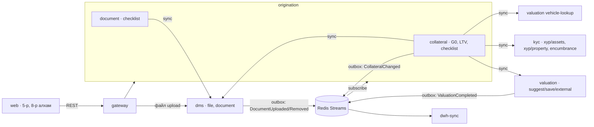

# 05 · Барьцаа, үнэлгээ ба баримт бичиг (Модуль 6 + 9): хэрэгжүүлэлтийн гарын авлага

Шаардлага: `docs/01` FR-6, FR-9, FR-14, G0, BR-3; `docs/03` §Барьцаа, үнэлгээ; `docs/04` Модуль 6, 9. Энэ баримт нь **юу хэрэгжсэн, яаж ажилладаг, ямар утга DEMO вэ** гэдгийг
тайлбарлана. Шийдвэр, таамгийг `docs/DECISIONS.md` (M6/M9 мөрүүд)-д, эзэнд тавих асуултыг §10-д жагсаав.

> **DEMO зарчим.** Гадаад холболт (ХУР, ЗМС, ЭБ, АТҮТ, гадны үнэлгээчин) болон бизнесийн шийдвэр (haircut, суурь үнэ, коэффициент, хүчинтэй хугацаа) хараахан
> баталгаажаагүй. Тиймээс бүгд **DEMO** утгатай, `INTEGRATION_MODE=mock`, нэг газраас солигдоно (§9). Mock нь deterministic fixture, зохиомол өгөгдөл.
> `INTEGRATION_MODE=real` үед бодит adapter `501 INTEGRATION_NOT_IMPLEMENTED` өгнө (таамагласан endpoint байхгүй).

## 1. Хамрах хүрээ

| Хэсэг | Шаардлага | Хаана |
| --- | --- | --- |
| Барьцаа CRUD, ХУР-аас сонгох | FR-6.1–6.3 | origination `modules/collateral`, kyc `xyp/assets` |
| Өмчлөлийн KYC | FR-6.5 | origination (тулгалт), kyc `xyp/property`, valuation `vehicle-lookup` |
| Ачаалал шалгах (ЗМС + ЭБ), давхар барьцаа | FR-6.6 | kyc `collateral-checks/encumbrance`, origination (`asset_key`) |
| Баримтын checklist (хөрөнгийн төрлөөр) | FR-6.7 | origination `collateral_document` |
| Лавлагааны хуучралт | FR-6.8 | setting `inquiry.stale_days` |
| ЭБ бүртгэл, мониторинг, чөлөөлөлт | FR-6.9 (S) | origination |
| Үнэлгээ: суурь үнэ × коэффициент, haircut, override, гадны үнэлгээ, түүх | FR-14.1–14.3, 14.5, 14.6 | valuation |
| LTV, G0 хаалт, 5-р алхам | FR-14.4, G0 | `@los/calc` `checkLtv`, origination |
| Хүсэлтийн баримт, product checklist, 8-р алхам | FR-9.1, 9.2 | dms `document`, origination `modules/document` |

**AC (docs/04 M6, M9)** — тест хаана: unit `30,000,000 × 0.7 = 21,000,000` (`packages/calc`, valuation); LTV 50M/21M > 70% → алхам PENDING (`collateral-gate` тест);
өмчлөгч өөр регистр → "Барьцаалагч бүртгэнэ үү" (`ownership-check` e2e); checklist дутуу → PENDING; ижил `registry_no`/`asset_key` өөр идэвхтэй хүсэлтэд → 409;
баримтын checklist 3 төрөл, 2 оруулахад PENDING, 3 → COMPLETED (`document` e2e).

## 2. Архитектур



* Ажилтан зөвхөн **origination**-тэй ярина (хүсэлтийн хүрээ NFR-3, төлөв, G0 нь тэнд). `dms/documents`, `valuation/valuate/collateral*` нь gateway-ийн ажилтны proxy-гоор **гарахгүй**
  (`INTERNAL_ONLY_PREFIXES`). Файл upload (`POST /api/dms/files`) хэвээр нээлттэй — файл өөрөө хүсэлтэд холбогдох нь origination-оор.
* Sync чиглэл CLAUDE.md §3.2-той нийцнэ: origination → {kyc, valuation, dms}. Сервис хоорондын FK байхгүй (`collateralId`, `fileId` нь string).
* Үнэлгээний үр дүн origination-ий `collateral` мөрөнд хуулагдана (docs/03: `market_value`, `haircut_rate`, `collateral_value`) — sync хариуг шууд, `ValuationCompleted` event-ийг нөөцөөр (идемпотент).

## 3. Origination API (`/api/origination/...`; gateway-ээр `/api/origination/...`)

Унших: OFFICER (өөрийн), BRANCH_MANAGER (салбар), APPROVER, ADMIN. Бичих: OFFICER (өөрийн хүсэлт), ADMIN; хүсэлтийн төлөв `DRAFT`/`RETURNED` (FR-10.4) — өөрөөр 409 `APPLICATION_NOT_EDITABLE`.
Үл хамаарах: үнэлгээ хадгалах/гадны үнэлгээ `ACTIVE` хүсэлтэд ч (дахин үнэлгээ, FR-14.6, алхам өөрчлөхгүй); ЭБ бүртгэл `APPROVED|DISBURSING|ACTIVE`; чөлөөлөлт `CLOSED`.

### 3.1 Барьцаа
| Метод · зам | Тайлбар |
| --- | --- |
| `GET /applications/:aid/collaterals` | `CollateralListResponse`: items, summary (Σ, LTV), gate (G0), warnings |
| `POST /applications/:aid/collaterals` | `CreateCollateralRequest` → 201 `CollateralMutationResponse` |
| `PATCH /applications/:aid/collaterals/:cid` | `UpdateCollateralRequest`; тодорхойлогч/өмчлөгч/тодорхойлолт өөрчлөгдвөл өмчлөл, ачаалал, үнэлгээ хүчингүй |
| `DELETE /applications/:aid/collaterals/:cid` | 204 |
| `GET /applications/:aid/collaterals/xyp-assets?ownerCustomerId=` | ХУР-ын хөрөнгө (`CollateralCandidatesResponse`), `alreadyPledged` тэмдэгтэй (FR-6.3) |
| `POST …/:cid/ownership-check` | `OwnershipCheckRequest` {method: REGISTRY\|DECLARED} → өмчлөлийн KYC (FR-6.5) |
| `POST …/:cid/encumbrance-check` | ЗМС + ЭБ (FR-6.6); бүртгэлгүй хөрөнгөнд DECLARED |
| `POST …/:cid/valuation/suggest` | системийн санал (хадгалахгүй) → `SuggestValuationResponse` |
| `POST …/:cid/valuation` | `SaveValuationRequest` {marketValue?, overrideReason?, mileageKm?} → үнэлгээ хадгалах |
| `POST …/:cid/valuation/external` | `ExternalValuationRequest` (гадны лицензтэй үнэлгээчин, тайлан файл заавал) |
| `GET …/:cid/valuations` | үнэлгээний түүх (`ValuationHistoryResponse`) |
| `POST …/:cid/documents` · `DELETE …/:cid/documents/:docId` | checklist баримт хавсаргах/хасах (`AttachCollateralDocumentRequest`) |
| `POST …/:cid/registry` | ЭБ бүртгэл {registryNo, registryDate} (FR-6.9) |
| `POST …/:cid/release` | зээл хаагдсан үед чөлөөлөх |
| `POST /applications/:aid/collaterals/recheck` | G0-г дахин тооцож 5-р алхмыг шинэчлэх (Модуль 5 зээлийн дүн өөрчлөгдсөн үед дуудна) |
| `GET /collaterals/monitoring?withinDays=30` | дахин үнэлэх / даатгал дуусах / LTV хэтэрсэн (FR-6.9, FR-14.6) |

Алдаа: `DomainError` — тогтвортой `code` + монгол `message`: `APPLICATION_NOT_EDITABLE` 409, `COLLATERAL_NOT_FOUND` 404, `COLLATERAL_DUPLICATE` 409 (энэ хүсэлтэд давхар), `COLLATERAL_ALREADY_PLEDGED` 409
(өөр идэвхтэй хүсэлтэд), `OWNER_NOT_ON_APPLICATION` 422, `OWNER_NOT_PLEDGOR` 422, `VALIDATION_FAILED` 400, valuation-ий `OVERRIDE_REASON_REQUIRED`/`MARKET_VALUE_REQUIRED` 422 дамжина.

### 3.2 Баримт бичиг
| Метод · зам | Тайлбар |
| --- | --- |
| `GET /applications/:aid/documents` | `ApplicationDocumentsResponse`: items, checklist (хангагдсан эсэх), extras, summary |
| `POST /applications/:aid/documents` | `AttachDocumentRequest` {fileId, checklistKey? \| type?, relatedEntity?, relatedId?, note?} → 201 `ApplicationDocumentMutationResponse` |
| `DELETE /applications/:aid/documents/:docId` | 200 `ApplicationDocumentMutationResponse` |
| `POST /applications/:aid/documents/:docId/ocr` | иргэний үнэмлэхийн регистрийг OCR-оор зээлдэгчтэй тулгана (`DocumentOcrCheck`; dms OCR-г дахин ашиглана) |

Баримтын checklist = `product.document_checklist_json` (`[{key, name, required}]`). Заавал түлхүүр бүрт ≥ 1 баримт байвал 8-р алхам COMPLETED, үгүй бол PENDING (FR-9.2).
Барьцааны баримт (`collateral_document`) нь тусдаа — §3.1.

## 4. Үнэлгээний сервис (valuation, `/api/...`)

> Эрх: valuation/dms/kyc-ийн дотоод endpoint-ууд `application:read`/`customer:read` шаардана — ADMIN-д `application:write` байхгүй тул origination дуудлагад дамжуулах хэрэглэгчийн эрхээр (ADMIN ч) орох ёстой.
> Бичих эрх, хүрээ, төлөвийн жинхэнэ шалгалт origination-д; ажилтны proxy эдгээр замыг гаргахгүй тул valuation-д давхар write-эрх шаардахгүй.

| Зам | Эрх | Тайлбар |
| --- | --- | --- |
| `POST /valuate/collateral/suggest` | `application:read` | `SuggestValuationRequest` → санал + haircut (хадгалахгүй) |
| `POST /valuate/collateral` | `application:read` | `SaveCollateralValuationRequest` → `collateral_valuation` мөр, `ValuationCompleted` event |
| `POST /valuate/collateral/external` | `application:read` | `RecordExternalValuationRequest` |
| `GET /valuate/collateral/:collateralId/history` | `application:read` | түүх (шинэ нь эхэнд) |
| `GET/POST /base-prices`, `POST /base-prices/import` | унших `application:read`; бичих `settings:manage` | суурь үнэ, хувилбар (FR-14.5) |
| `GET/PUT /haircuts` | унших `application:read`; бичих `settings:manage` | haircut-ийн дүрэм |

**Зах зээлийн үнийн санал (FR-14.1)** — `@los/calc` `collateral-value.ts` цэвэр функц:

| Төрөл | Арга (`ValuationMethod`) | Томъёо |
| --- | --- | --- |
| VEHICLE | `VEHICLE_MARKET_COMPARABLES` (улсын дугаар → АТҮТ → зарын жишиг; `AutoValuationService`), боломжгүй бол `VEHICLE_BASE_PRICE` | суурь үнэ(марк/загвар/он) × (1 − элэгдэл(нас)) × (1 − гүйлтийн хасалт) |
| APARTMENT, HOUSE | `REALTY_BASE_PRICE` | м² суурь үнэ(дүүрэг, хороо) × талбай × давхрын × зориулалтын × барилгын насны коэффициент |
| LAND | `LAND_BASE_PRICE` | м² суурь үнэ × талбай × зориулалтын коэффициент |
| LIVESTOCK | `LIVESTOCK_UNIT_PRICE` | нэгж үнэ(төрөл, нас) × тоо толгой |
| INVENTORY | `INVENTORY_STOCKTAKE` | тооллогын үнэ (ЗЭЗ оруулна) |
| EQUIPMENT, OTHER | `MANUAL` | ЗЭЗ оруулна |

**Барьцааны үнэлгээ = зах зээлийн үнэ × haircut (FR-14.2).** Haircut-ийн эрэмбэ: (1) `haircut_rule(product, assetType)` → (2) `product.haircut_json[assetType]` (origination дамжуулна) →
(3) `haircut_rule(null, assetType)` → (4) DEMO default (`HaircutSource` хариунд заана). Системийн саналыг ЗЭЗ засвал (эсвэл санал байхгүй үед) `overrideReason` **заавал** —
`INVENTORY/EQUIPMENT/OTHER`-д (санал өгдөггүй) шаардахгүй. Үнэлгээ хүчинтэй хугацаа: дотоод `valuation.internal_validity_days`, гадны `valuation.external_validity_days`.
Зах зээлийн үнэ ≥ `product.external_valuation_threshold` бол **гадны лицензтэй үнэлгээ заавал** (`externalRequired`, FR-14.3).

## 5. kyc (`/api/...`)

| Зам | Эрх | Тайлбар |
| --- | --- | --- |
| `POST /xyp/assets` | `customer:read` | регистрийн эзэмшлийн үл хөдлөх + тээврийн хэрэгсэл (FR-6.3) |
| `POST /xyp/property` | `customer:read` | өмчлөх эрхийн дугаараар өмчлөгчид (FR-6.5) |
| `POST /collateral-checks/encumbrance` | `customer:read` | ЗМС + ЭБ ачаалал (FR-6.6); эх сурвалж унавал 503 `ENCUMBRANCE_UNAVAILABLE` (fail closed) |

Mock DEMO fixture: §9.

## 6. G0 хаалт ба 5-р алхам

`evaluateCollateralGate` (цэвэр функц, `collateral-gate.ts`) нь үнэлгээ/шалгалтын хуулбар, бүтээгдэхүүн, setting, одоогийн цагийг аваад `CollateralGate`, `CollateralSummary`, барьцаа бүрийн `issues`-ыг буцаана.
Алхам `collateral`: `gate.complete` → `COMPLETED` (`completed_at`), үгүй бол `PENDING`. `LOCKED` алхамд хүрэхгүй (Модуль 2 нээнэ). Барьцаа, үнэлгээ нэмэх/засах/хасахад `score` алхам `COMPLETED` бол `STALE` (`COLLATERAL_CHANGED`).

| Код | Шалгуур |
| --- | --- |
| `PRODUCT_MISSING` | хүсэлтэд бүтээгдэхүүн сонгоогүй (4-р алхам) |
| `NO_COLLATERAL` | `requires_collateral=true` ба барьцаа алга. `requires_collateral=false` ба барьцаа алга → `skipped=true`, `complete=true` (FR-6.4) |
| `LOAN_AMOUNT_MISSING` | барьцаа байгаа ч зээлийн дүн алга → LTV тооцох боломжгүй |
| `OWNERSHIP_NOT_CHECKED` / `OWNERSHIP_STALE` / `OWNER_MISMATCH` / `OWNER_NOT_ON_APPLICATION` | `ownership.status≠VERIFIED` эсвэл `inquiry.stale_days`-аас хуучирсан (FR-6.5, FR-6.8) |
| `ENCUMBRANCE_NOT_CHECKED` / `ENCUMBRANCE_STALE` / `ENCUMBERED` / `ENCUMBRANCE_DISPUTED` | ачаалал `CLEAR` биш эсвэл хуучирсан (FR-6.6, FR-6.8) |
| `DUPLICATE_PLEDGE` | `asset_key`/`registry_no` өөр **идэвхтэй** (SUBMITTED, IN_APPROVAL, APPROVED, DISBURSING, ACTIVE, MIGRATED) хүсэлтийн чөлөөлөгдөөгүй барьцаанд байна |
| `CHECKLIST_INCOMPLETE` | `product.collateral_checklist_json[assetType]`-ийн заавал түлхүүр бүрт баримт алга (FR-6.7) |
| `NOT_VALUED` / `VALUATION_EXPIRED` / `EXTERNAL_VALUATION_REQUIRED` | үнэлгээ алга / `valid_until` өнгөрсөн / босгоос дээш боловч гадны үнэлгээгүй |
| `LTV_EXCEEDED` | LTV = зээл ÷ Σ барьцааны үнэлгээ > `product.max_ltv ?? setting br3.ltv_max` (BR-3) |

Хүсэлтийн төлөв `DRAFT`/`RETURNED` өөр хүсэлтэд ижил хөрөнгө байвал зөвхөн анхааруулга (`IN_OTHER_DRAFT`) — хориг биш. Илгээх (G1, Модуль 10) үед `CollateralGateService.evaluate` дахин дуудагдаж давхар барьцааг дахин шалгана.

## 7. Өгөгдөл (incremental migration; baseline-д хүрээгүй)

* origination `20261029070000_collateral_documents`: `collateral` + `asset_key`, `xyp_ref`, `note`, `valuation_id`, `valuation_source`, `valued_at`, `valuation_valid_until`, `valuation_override_reason`,
  `external_valuation_required`; unique `(application_id, asset_key)`, index `(org_id, asset_key)`; `collateral_document` + `file_name`, `mime`, `size`, `note`.
* valuation `20261029070000_collateral_valuation_detail`: `collateral_valuation` + `method`, `suggested_value`, `haircut_source`, `external_required`, `license_no`.
* dms: хүснэгтийн өөрчлөлтгүй (`document` baseline-д бий).
* Регистр, нэр зэрэг хувийн мэдээлэл: `ownership_check_json`-д зөвхөн далдлагдсан регистр (`УБ****5678`), `matchedCustomerId`; лог/аудитад бичихгүй.

## 8. Event

| Event | Гаргагч | Сонсогч | Тэмдэглэл |
| --- | --- | --- | --- |
| `ValuationCompleted` (+ нэмэлт: valuationId, assetType, source, haircutRate, valuedAt, validUntil, externalRequired) | valuation | origination (нөөц синк), dwh | version 1, нэмэлт талбар нь optional |
| `DocumentUploaded` (+ relatedEntity, relatedId, checklistKey, fileId) · `DocumentRemoved` | dms | origination (checklist дахин тооцох), dwh | |
| `CollateralChanged` {change: ADDED, UPDATED, REMOVED, VALUED, OWNERSHIP_CHECKED, ENCUMBRANCE_CHECKED, DOCUMENT_CHANGED, PLEDGE_REGISTERED, RELEASED} | origination | dwh | |

## 9. DEMO утга ба тэдгээрийг солих газар

| Юу | DEMO утга | Солих газар |
| --- | --- | --- |
| Haircut | VEHICLE 0.70, APARTMENT 0.80, HOUSE 0.75, LAND 0.60, LIVESTOCK 0.50, INVENTORY 0.50, EQUIPMENT 0.60, OTHER 0.40 (docs/04 M6 AC) | valuation `haircut_rule` (admin API) / `product.haircut_json` |
| Үнэлгээ хүчинтэй хугацаа | дотоод 90, гадны 365 хоног | setting `valuation.*_validity_days` |
| Дахин үнэлгээ / даатгалын сануулга | 365 / 30 хоног | setting `collateral.revaluation_interval_days`, `collateral.insurance_reminder_days` |
| Лавлагааны хуучралт | 30 хоног | setting `inquiry.stale_days` (FR-3.5) |
| LTV дээд | 70% | `product.max_ltv` эсвэл setting `br3.ltv_max` |
| Гадны үнэлгээний босго | бизнесийн болон автомашины зээлд 100,000,000₮ | `product.external_valuation_threshold` |
| Суурь үнэ (м², мал, автомашин), коэффициент, элэгдэл | `apps/valuation/prisma/seed.ts`, `DemoCollateralPricing` | admin `base-prices` API; коэффициент → тохиргооны порт (DEMO) |
| ХУР / ЗМС / ЭБ | mock fixture (`apps/kyc/src/integrations/{xyp,encumbrance}`) | `INTEGRATION_MODE=real` + бодит adapter (`TODO(human)`) |
| АТҮТ | `apps/valuation/src/integrations/vehicle-registry` (хуучин) | ижил |
| Гадны үнэлгээчний лиценз | шалгахгүй (чөлөөт текст) | бодит лицензийн бүртгэл |

Mock fixture-ийн холболт: valuation-ий mock АТҮТ-д `УЕН5246` (өмчлөгч `УЕ00000001`), `5678УНА` (`ЖИ00000002`), `1234УБА` (компани `0000001`); kyc mock ХУР энэ регистрүүдэд ижил автомашин
буцаана, мөн үл хөдлөх хөрөнгийг регистрээс тогтвортой үүсгэнэ. Ачаалал: өмчлөх эрхийн/улсын дугаар/серийн **сүүлийн цифр 7** → `ENCUMBERED` (ЗМС: `Жишээ ББСБ`), **9** → `DISPUTED` (ЭБ), бусад `CLEAR`.

## 10. Нээлттэй асуултууд (эзэнд)

`docs/DECISIONS.md`-д (2026-10-29, M6/M9 мөрүүд) бүртгэсэн. Эзэн шийдэх зүйлс (хөгжүүлэлтэд DEMO/анхдагчаар явна):

1. Автомашины суурь үнийн жагсаалт шинэ машины лавлах үнэ юу (жилд 3%, дээд 50% элэгдүүлнэ) эсвэл ашигласан машины одоогийн үнэ юу (элэгдэл 0)?
2. Байшин (HOUSE)-ийн үнэлгээнд зөвхөн барилга уу, доорх газрыг нэмэх үү? (одоо: барилга; газар тусдаа LAND барьцаа)
3. Давхарын, зориулалтын, барилгын насны, газар ашиглалтын коэффициент, гүйлтийн хасалт, суурь үнийн хуучралтын хугацаа: бодит утгууд (одоо `DemoCollateralPricing` DEMO).
4. Haircut-ийн хувь хөрөнгийн төрөл бүрээр (одоо DEMO хүснэгт).
5. FR-6.6 «хоёрдогч барьцаа үлдэгдэл үнэлгээгээр» зөвшөөрөх үү? (одоо хатуу хориг)
6. Гадны үнэлгээ: хүчинтэй хугацааг `valuation.external_validity_days`-ээр хязгаарлах, лицензийн дугаар заавал болгох уу? (одоо хязгааргүй)
7. Иргэний үнэмлэхийн OCR зөрүү (MISMATCH) 8-р алхамыг/илгээхийг хориглох уу, зөвөлгөө хэвээр үү? (одоо зөвөлгөө)
8. BRANCH_MANAGER, APPROVER баримт нэмж/хасч болох уу? (одоо зөвхөн харна)
9. FR-9.2 «баримт дутуу бол илгээхгүй»: `br7.required_steps`-д `document`-ийг оруулах уу (Модуль 10)?
10. Хүсэлт бүрийн барьцаа тус бүрийн баримтын дээд тоо (одоо 20, DEMO); ЭБ бүртгэлийн дугаарыг дараа нь зөвхөн ADMIN засах уу?
11. Бүртгэлийн өмчлөгчийн нэрийг `ownership_check_json`-д хадгалах нь зөвшөөрөгдөх үү (одоо хадгална; зөвхөн далдлагдсан регистр гэж spec-д)?
12. Бодит ЗМС/ЭБ, ХУР (assets/property), АТҮТ-ийн хандалт, гэрээ, spec (adapter одоо stub, `INTEGRATION_MODE=real` → 501).

## 11. Хөгжүүлэлт, тест

```bash
pnpm --filter @los/contracts build && pnpm --filter @los/calc build
pnpm --filter @los/origination db:generate && pnpm --filter @los/valuation db:generate      # шинэ багана
TEST_DATABASE_URL=postgresql://los@127.0.0.1:5432/los_a_test REDIS_URL=redis://127.0.0.1:6379/1 pnpm --filter @los/origination test
```

DB-тэй тест `describe.skipIf(!HAS_DB)`. `@los/calc` `collateral-value.ts` 100% coverage (`packages/calc/vitest.config.ts`).
