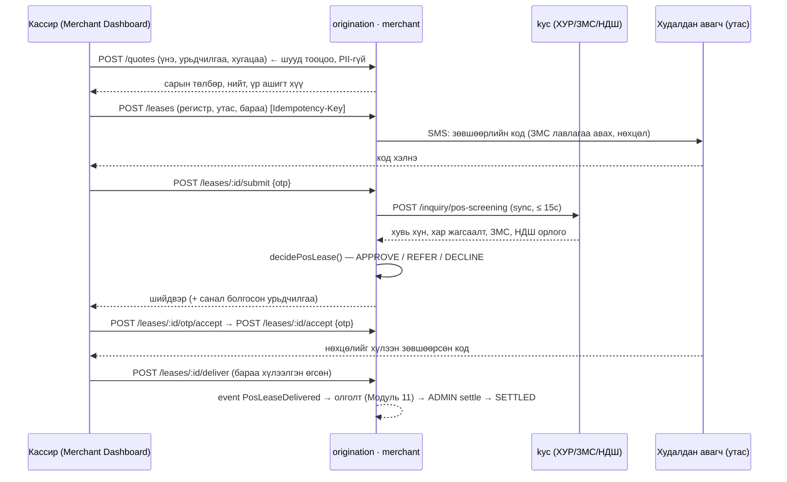

# LOS Radix — Мерчант POS портал (B2B2C) — шаардлага ба дизайн

Огноо: 2026-10-28 · Эзэмшигч: Altanabagana · Хамаарах хүрээ: бизнес эзэмшигчийн сайжруулалтын санал №1 (Point-of-Sale лизинг, Merchant Dashboard).
Холбоотой код: `packages/contracts/src/merchant.ts`, `packages/calc/src/pos-lease.ts`, `apps/origination/src/modules/merchant/`, `apps/web/src/app/merchant/`, `apps/web/src/app/settings/merchants/`.
ID-ийн угтвар: `POS-FR-*` (функциональ), `POS-BR-*` (бизнес дүрэм), `POS-NFR-*`.

## 1. Зорилго, хамрах хүрээ

LOS-ийг зөвхөн лизингийн байгууллагын ажилтан бус **гэрээт мерчант (жижиглэн худалдааны дэлгүүр: зөөврийн компьютер, цахилгаан бараа, ширээний тоглоом …)** ашиглана. Мерчантын кассир худалдан авагчид газар дээр нь **~1 минутын дотор** лизингийн шийдвэр гаргаж өгнө; мерчант өөрийн борлуулалт, батлагдсан/хүлээгдэж буй төлбөрөө **Merchant Dashboard**-оос хянана.

| Хамрах | Хамаарахгүй (өөр сайжруулалт/модуль) |
| --- | --- |
| Мерчант, дэлгүүр (store), лизингийн хөтөлбөр (plan) удирдлага | №2 Барьцаа хөрөнгийн автомат үнэлгээ (valuation) — POS-д барьцаа нь худалдан авсан бараа өөрөө |
| Үнийн санал (quote) ба шууд шийдвэр (APPROVE / REFER / DECLINE) | №3 Тоон гарын үсэг (Tridum/Monpass), PDF гэрээ, DMS — одоо SMS OTP-ээр зөвшөөрлийг баталгаажуулна (§10 seam) |
| Зөвшөөрлийн OTP, санал хүлээн авах, хүлээлгэн өгөх, мерчантад төлөх | №4 Эрсдэлд суурилсан үнэ тогтоолт (Sosco Score) — одоо хүү нь plan-аас (§10 seam) |
| Merchant Dashboard, мерчант порталын хуудсууд | Гэрээний дугаар (BR-11), ЭТХ (Модуль 7), Core-д данс нээх (Модуль 11) — event-ээр холбоно |
| Лизингийн байгууллагын back-office: мерчант бүртгэл, хөтөлбөр, REFER хянах, төлбөр шилжүүлэх | Буцаалт/нөхөн төлбөр (бараа буцаах) — дараагийн хувилбар |

## 2. Оролцогчид, эрх

| Дүр | Хэн | Эрх | Хүрээ |
| --- | --- | --- | --- |
| `MERCHANT_STAFF` | Дэлгүүрийн кассир | Үнийн санал, лизинг үүсгэх/удирдах, dashboard | **Зөвхөн өөрийн дэлгүүр** (`X-Store-Id`) |
| `MERCHANT_ADMIN` | Мерчантын эзэн/менежер | Дээрхийг бүх дэлгүүрээр, дэлгүүрээр шүүх | Өөрийн мерчант (`X-Merchant-Id`) |
| `ADMIN` | Лизингийн байгууллагын админ | Мерчант/дэлгүүр/хөтөлбөр CRUD, төлөв өөрчлөх, төлбөр шилжүүлэх (settle), REFER хянах | Бүгд |
| `APPROVER` | Төв/зээлийн хороо | REFER хянах (батлах/татгалзах), лизинг харах | Бүгд |
| `BRANCH_MANAGER` | Салбарын захирал | Өөрийн салбарын мерчантын лизинг харах, REFER хянах | `merchant.branch_id = X-Branch-Id` |
| Худалдан авагч | Эцсийн хэрэглэгч | Утсанд ирсэн OTP-ээр зөвшөөрөх/санал хүлээн авах (системд нэвтрэхгүй) | — |

Gateway нь `X-Roles`-д дүрүүдийг, `X-Merchant-Id`, `X-Store-Id`, `X-Org-Id`-ийг (`GATEWAY_HEADERS`, contracts) дамжуулна. Сервис толгойд итгэнэ (CLAUDE.md §3.2.9); мерчантын хүрээний шалгалтыг **origination дахин хийнэ** (§8) — gateway-н алдаа tenant-ийн хилийг эвдэхгүй.

## 3. Процесс — 1 минутын урсгал

**Цагийн төсөв (POS-NFR-1):** quote ≤ 1с; submit (гадаад лавлагаа орно) ≤ 15с p95; кассирын эхлэлээс шийдвэр хүртэл ≤ 60с. Dashboard-д `avgDecisionSeconds` (лизинг үүссэнээс шийдвэр гарах хүртэл) харуулж хэмжинэ.

## 4. Төлвийн мөчлөг

| Төлөв | Утга | Дараагийн төлөв | Хэн/юу шилжүүлнэ |
| --- | --- | --- | --- |
| `DRAFT` | Үүссэн, зөвшөөрлийн OTP хүлээж байна (эсвэл баталгаажсан ч шийдвэр гарч амжаагүй) | `APPROVED` `REFERRED` `DECLINED` `CANCELLED` `EXPIRED` | submit (систем) |
| `REFERRED` | Автомат батлах боломжгүй — лизингийн байгууллага гараар хянана | `APPROVED` `DECLINED` `CANCELLED` `EXPIRED` | `POST /pos-leases/:id/review` |
| `APPROVED` | Санал бэлэн, `expiresAt` хүртэл хүчинтэй | `ACCEPTED` `CANCELLED` `EXPIRED` | accept (OTP) |
| `DECLINED` | Татгалзсан (терминал) | — | — |
| `ACCEPTED` | Худалдан авагч нөхцөлийг OTP-ээр баталгаажуулсан | `DELIVERED` `CANCELLED` | deliver |
| `DELIVERED` | Бараа хүлээлгэн өгсөн; мерчантад төлөх дүн (`merchantNetAmount`) үүссэн | `SETTLED` | `POST /pos-leases/:id/settle` (ADMIN) |
| `SETTLED` | Мерчантад төлсөн (терминал) | — | — |
| `CANCELLED` / `EXPIRED` | Цуцалсан / хугацаа дууссан (терминал) | — | cancel / lazy expiry |

`allowedActions` (сервер буцаана, UI давтахгүй): `DRAFT` → `SUBMIT` (+ зөвшөөрөл баталгаажаагүй бол `RESEND_CONSENT_OTP`), `CANCEL`; `REFERRED` → `CANCEL`; `APPROVED` → `REQUEST_ACCEPT_OTP`, `ACCEPT`, `CANCEL`; `ACCEPTED` → `DELIVER`, `CANCEL`; бусад → хоосон.
**Хугацаа дуусалт:** `expires_at` (DRAFT = үүссэнээс `POS_DRAFT_TTL_MINUTES` (60), REFERRED = `POS_REFERRAL_TTL_HOURS` (72), APPROVED = шийдвэрээс `policy.offerTtlMinutes` (30)). Уншилт/үйлдэл бүрт *lazy* шалгаж `EXPIRED` болгоно; dashboard `effectiveStatus`-аар тоолно. Хуваарьт цэвэрлэгээ (BullMQ) Модуль 0-д ирэхэд `LeaseService.expireStale()`-г дуудна.
**HTTP-д** хориотой шилжилт → 409 `INVALID_TRANSITION`; зэрэгцээ өөрчлөлт (optimistic `version`) → 409 `CONCURRENT_UPDATE`.

## 5. Бизнес дүрэм

| ID | Дүрэм |
| --- | --- |
| POS-BR-1 | Санхүүжилт `F = бараа үнэ − урьдчилгаа`; урьдчилгаа ≥ `plan.minDownPaymentRate × үнэ`; `F` ∈ [`plan.minAmount`, `plan.maxAmount`] ба ≤ `merchant.maxTicketAmount` |
| POS-BR-2 | Зээлийн үндсэн дүн = `F + F × plan.feeRate` (олголтын шимтгэл нэмэгдэнэ); сарын төлбөр = annuity(`@los/calc` `annuityPayment`); хугацаа ∈ `plan.termOptions` |
| POS-BR-3 | Мерчантын шимтгэл = `F × (plan.commissionRate ?? merchant.commissionRate)`; мерчантад төлөх = `F − шимтгэл`. Урьдчилгааг худалдан авагч мерчантад шууд төлнө |
| POS-BR-4 | Шууд шийдвэр `decidePosLease()`: DECLINE (нас, хугацаа хэтрэлт ≥ `declineDpd`, FICO < `declineFico`, ӨОХ > `referDti`) > REFER (хар жагсаалт — **BR-9: хориг биш**, PEP, орлого баталгаажаагүй, ЗМС байхгүй, ӨОХ ∈ (`maxDti`, `referDti`], идэвхтэй зээл олон, дүн `autoApproveMaxAmount`-аас их …) > APPROVE. Параметр = `POS_POLICY_DEFAULTS` (DEMO; BR-1 ӨОХ ≤ 55%) ← `plan.policy`-оор дарна. `autoDeclineEnabled=false` бол бүх DECLINE → REFER |
| POS-BR-5 | Орлого = НДШ-ээс баталгаажсан сарын дундаж. Кассир орлого оруулахгүй (1 минут + залилангийн эрсдэл). Баталгаажаагүй бол REFER |
| POS-BR-6 | **Зээлийн мэдээллийн нууцлал:** мерчантад зөвхөн `publicReason` (`AFFORDABILITY`/`CREDIT_POLICY`/`ELIGIBILITY`/`MANUAL_REVIEW`) ба зөвхөн ӨОХ-оос шалтгаалсан үед `suggestedMinDownPayment` харагдана. Хар жагсаалт, PEP, ЗМС, орлого, ӨОХ-ийн утга, чадамжийн дүн **мерчантад ил гарахгүй**; зөвхөн back-office (`PosLeaseAdminView.review`) |
| POS-BR-7 | Худалдан авагчийн регистр/утсыг хадгалахдаа регистрийг шифрлэнэ (`PiiCipher`), хайлтын hash (HMAC) тусад нь; API-д үргэлж маскалж (`УЕ******01`, `99****12`) буцаана; лог, event-д бичихгүй |
| POS-BR-7a | Зөвшөөрөл (consent) = `CONSENT` OTP-ийн баталгаажуулалт; баталгаажаагүй лизингэд лавлагаа татахгүй. `consent_text_version` хадгална |
| POS-BR-8 | OTP: 6 орон, `POS_OTP_TTL_SECONDS` (300) хүчинтэй, `POS_OTP_MAX_ATTEMPTS` (3) оролдлого, дахин илгээх хязгаар `POS_OTP_RESEND_SECONDS` (30), лизинг тутамд ≤ 5 илгээлт. Код HMAC-аар (`POS_OTP_SECRET`) hash болж хадгалагдана, шууд харьцуулахгүй (timing-safe) |
| POS-BR-9 | Өдрийн лимит: тухайн мерчантын өнөөдөр (Asia/Ulaanbaatar, UTC+8) `ACCEPTED+` лизингийн `F`-ийн нийлбэр + шинэ `F` ≤ `merchant.dailyLimitAmount` (accept үед шалгана) |
| POS-BR-10 | Мерчант `ACTIVE` бол л шинэ лизинг үүснэ/accept хийгдэнэ; `SUSPENDED` бол нээлттэй лизинг дуусгах боломжтой (deliver зөвшөөрнө), шинэ үүсгэхгүй. `TERMINATED` → бүх үйлдэл хориотой |
| POS-BR-11 | Хөтөлбөр: `isActive`, `validFrom ≤ now ≤ validTo`, `goodsCategories`-д бараа багтана, `merchantId` null эсвэл тухайн мерчант |
| POS-BR-12 | Давхар хүсэлтээс хамгаалах: `POST /leases` дээр `Idempotency-Key` заавал; ижил key + ижил бие → ижил лизинг (200), өөр бие → 409 `IDEMPOTENCY_CONFLICT` |
| POS-BR-13 | Лизинг бүр салбартай (BR-12): `branch_id = merchant.branch_id`; ЗЭЗ = "Систем" (`officer_id = null`) |

## 6. Функциональ шаардлага

| ID | Шаардлага | Эрэмбэ |
| --- | --- | --- |
| POS-FR-1 | Мерчант бүртгэх/засах/төлөв өөрчлөх (PENDING→ACTIVE→SUSPENDED→TERMINATED, шалтгаан заавал), settlement данс (шифрлэгдэж, `****1234` харагдана) | M |
| POS-FR-2 | Мерчантын дэлгүүр (store) CRUD | M |
| POS-FR-3 | Лизингийн хөтөлбөр (plan) CRUD: ангилал, дүн, хугацааны сонголт, хүү, шимтгэл, доод урьдчилгаа, шимтгэлийн override, `policy` override, хүчинтэй хугацаа | M |
| POS-FR-4 | Quote: үнэ+урьдчилгаа+хугацаа → сарын төлбөр, нийт, үр ашигт хүү, мерчантын цэвэр дүн (PII-гүй, шууд) | M |
| POS-FR-5 | Лизинг үүсгэх → зөвшөөрлийн OTP → submit → шууд шийдвэр (§3,§5) | M |
| POS-FR-6 | Санал хүлээн авах (OTP), хүлээлгэн өгөх, цуцлах; төлөв бүрт `allowedActions` | M |
| POS-FR-7 | Merchant Dashboard: хүсэлт/батлагдсан/татгалзсан/REFER тоо, батлагдах хувь, хөрвөлт, дундаж шийдвэрийн хугацаа, санхүүжилт, борлуулалт, шимтгэл, хүлээгдэж буй/төлөгдсөн цэвэр дүн, өдөр тутмын график, дэлгүүр/хөтөлбөрөөр, "хийх ажил" (OTP хүлээж буй, санал хүлээн авах, хүлээлгэн өгөх, REFER), өдрийн лимитийн ашиглалт, сүүлийн лизингүүд | M |
| POS-FR-8 | Лизингийн жагсаалт (төлөв, дэлгүүр, огноо, хайлт `q`: лизингийн № (хэсэг) / утасны сүүлийн 4–8 орон / бүтэн регистр (hash-аар)), дэлгэрэнгүй + timeline | M |
| POS-FR-9 | Back-office: бүх мерчантын лизингийн жагсаалт, REFER хянах (батлах/татгалзах, тайлбар заавал), settle (settlementRef) | M |
| POS-FR-10 | Event: `PosLeaseDecided/Accepted/Delivered/Settled/Cancelled`, `MerchantStatusChanged` (outbox) → dwh, origination.application | M |
| POS-FR-11 | Аудит: лизинг бүрийн timeline (`pos_lease_event`): хэн, хэзээ, өмнөх→шинэ төлөв | M |
| POS-FR-12 | Хөтөлбөрийн үнэлгээ/үнийн seam (§10): item №2, №4, №3 орох цэгүүд | S |
| POS-FR-13 | Excel экспорт (мерчант жагсаалт), мерчантын өөрийн ажилтан удирдлага (iam) — дараагийн хувилбар | C |

## 7. Өгөгдлийн загвар (schema `origination`, docs/03 дүрэм: `id`, `created_at`, `updated_at`, `created_by`, `updated_by`, `org_id`; мөнгө `numeric(18,2)`, хувь `numeric(7,4)`)

| Хүснэгт | Үндсэн талбарууд |
| --- | --- |
| `merchant` | code (unique per org), name, legal_name, company_register_no, category, contact_name, phone, email, **branch_id**, status, status_reason, commission_rate, max_ticket_amount, daily_limit_amount, settlement_bank_code, **settlement_account_encrypted**, settlement_account_last4, settlement_holder_name, contract_no, contract_signed_at |
| `merchant_store` | merchant_id, code (unique per merchant), name, address_json, phone, is_active |
| `pos_lease_plan` | merchant_id (null = бүгд), code (unique per org), name, product_id (string, FK биш), goods_categories_json, min_amount, max_amount, term_options_json, annual_rate, fee_rate, min_down_payment_rate, commission_rate (null), policy_json, valid_from, valid_to, is_active |
| `pos_lease` | lease_no (unique), merchant_id, store_id, plan_id, plan_code, plan_name, branch_id, status, version, idempotency_key + request_hash (unique per merchant), buyer_register_encrypted, buyer_register_hash, buyer_register_masked, buyer_phone, buyer_last_name, buyer_first_name, goods_category/name/serial_no/price, **quote_json** (PosQuote snapshot) + талбар тус бүр: down_payment, financed_amount, fee_amount, principal, term_months, annual_rate, monthly_payment, merchant_commission_amount, merchant_net_amount, decision, decision_reasons_json, dti_ratio, affordability_json, screening_json (бүрэн бус: PII-гүй хураангуй), decided_at, decided_by, decision_comment, consent_verified_at, consent_text_version, expires_at, accepted_at, delivered_at, delivered_by, settled_at, settlement_ref, cancelled_at, cancel_reason, **application_id** (string, `loan_application`-тай холбох; хоосон) , created_by (user id) |
| `pos_lease_otp` | lease_id, purpose, code_hash, expires_at, attempts, sent_to_masked, sent_at, verified_at |
| `pos_lease_event` | lease_id, at, action, from_status, to_status, actor_id, actor_label, data_json |
| `outbox` | (байгаа) — event-ийг бизнес транзакцтай нэг tx-д |

Cross-schema FK байхгүй: `branch_id`, `product_id`, `application_id`, `created_by` нь string ID.

## 8. API (gateway `/api/origination/...` → origination `/api/...`)

Бүх хариу JSON; алдаа `{ code, message, details? }` (`MerchantErrorBody`, `MerchantErrorCode`); `X-Correlation-Id` дамжуулна. Хүсэлтийн бие `@los/contracts`-ын zod схемээр шалгагдана.

**Мерчант портал** — `MERCHANT_ADMIN`, `MERCHANT_STAFF`. Хүрээ: `X-Merchant-Id` заавал; `MERCHANT_STAFF` бол `X-Store-Id` заавал, өөр дэлгүүрийн лизинг → 404 (оршин байгааг задруулахгүй).

| Method | Path | Бие → Хариу |
| --- | --- | --- |
| GET | `/merchant-portal/me` | → `MerchantProfile` (хөтөлбөрүүд хамт) |
| GET | `/merchant-portal/dashboard?from&to&storeId` | → `MerchantDashboard` (STAFF → storeId албадан өөрийнх) |
| POST | `/merchant-portal/quotes` | `PosQuoteRequest` → `PosQuote` |
| POST | `/merchant-portal/leases` | `PosLeaseCreate` (+ `Idempotency-Key`) → 201 `PosLeaseWithOtp` (replay → 200) |
| GET | `/merchant-portal/leases` | `PosLeaseListQuery` → `Paged<PosLeaseListItem>` |
| GET | `/merchant-portal/leases/:id` | → `PosLeaseView` |
| POST | `/merchant-portal/leases/:id/otp/consent` | → `OtpSent` (зөвшөөрлийн кодыг дахин илгээх) |
| POST | `/merchant-portal/leases/:id/submit` | `PosLeaseSubmit` → `PosLeaseView` (шийдвэртэй) |
| POST | `/merchant-portal/leases/:id/otp/accept` | → `OtpSent` (зөвхөн APPROVED) |
| POST | `/merchant-portal/leases/:id/accept` | `PosLeaseAccept` → `PosLeaseView` |
| POST | `/merchant-portal/leases/:id/deliver` | `PosLeaseDeliver` → `PosLeaseView` |
| POST | `/merchant-portal/leases/:id/cancel` | `PosLeaseCancel` → `PosLeaseView` |

**Back-office** — мерчант/дэлгүүр/хөтөлбөрийн бичих үйлдэл `ADMIN`; унших `ADMIN`, `APPROVER`, `BRANCH_MANAGER` (BRANCH_MANAGER зөвхөн `merchant.branch_id = X-Branch-Id`); `X-Org-Id` заавал.

| Method | Path | Эрх | Бие → Хариу |
| --- | --- | --- | --- |
| POST / GET | `/merchants` | ADMIN / унших | `MerchantCreate` → `MerchantView`; `MerchantListQuery` → `Paged<MerchantView>` |
| GET / PATCH | `/merchants/:id` | унших / ADMIN | `MerchantUpdate` → `MerchantView` |
| POST | `/merchants/:id/status` | ADMIN | `MerchantStatusChange` → `MerchantView` (+ `MerchantStatusChanged`) |
| POST / GET | `/merchants/:id/stores` | ADMIN / унших | `StoreCreate` → `StoreView` ; → `StoreView[]` |
| PATCH | `/merchants/:id/stores/:storeId` | ADMIN | `StoreUpdate` → `StoreView` |
| POST / GET | `/pos-plans` | ADMIN / унших | `PlanCreate` → `PlanView`; `?merchantId&isActive` → `PlanView[]` |
| PATCH | `/pos-plans/:id` | ADMIN | `PlanUpdate` → `PlanView` |
| GET | `/pos-leases`, `/pos-leases/:id` | унших | `PosLeaseAdminListQuery` → `Paged<PosLeaseListItem>`; → `PosLeaseAdminView` |
| POST | `/pos-leases/:id/review` | ADMIN, APPROVER, BRANCH_MANAGER | `PosLeaseReview` → `PosLeaseAdminView` (зөвхөн REFERRED) |
| POST | `/pos-leases/:id/settle` | ADMIN | `PosLeaseSettle` → `PosLeaseAdminView` (зөвхөн DELIVERED) |

**Gateway холболт (Module 0-ийн дараах follow-up):** Module 0-ийн gateway `/api/<service>/<зам>` → `<service>/api/<зам>` proxy-той тул вэб merchant API-г `/api/origination/merchant-portal/*`, `/api/origination/merchants*`, `/api/origination/pos-*` замаар дууддаг (`apps/web/src/lib/merchant-api.ts` `ORIGINATION_API`). `X-Merchant-Id`, `X-Store-Id` нь `CTX_HEADERS`-д орсон тул gateway клиентийн ирүүлсэн утгыг устгадаг (spoofing-гүй) боловч **JWT-аас тавих логик хараахан үгүй**. Үлдсэн ажил: мерчант хэрэглэгчийг `iam.user.merchant_id/store_id` талбараар таних (gateway миграци) + JWT claim → `X-Merchant-Id`/`X-Store-Id` тавих; `MERCHANT_ADMIN`/`MERCHANT_STAFF` дүрийг `UserRole`/`ROLE_PERMISSIONS`-д нэмэх; мерчант дүрээр лизингийн байгууллагын замууд (`/los/*`, `/settings/*`) руу хандахыг хаах; rate limit (POS нэвтрэлт, OTP). Тэр болтол origination талын хаалт (`ContextGuard` + `RolesGuard` + мерчантын хүрээний шалгалт) бие даан хамгаална.

## 9. Event (contracts/events.ts, PII-гүй)

| Event | Хэзээ | Сонсогч |
| --- | --- | --- |
| `PosLeaseDecided` | submit-ийн шийдвэр, review | dwh, мэдэгдэл (REFER → back-office) |
| `PosLeaseAccepted` | accept | origination.application (loan_application source=POS, гэрээ, ЭТХ — Модуль 2/7/11), dms, dwh |
| `PosLeaseDelivered` | deliver | origination.disbursement (мерчантад төлөх), dwh |
| `PosLeaseSettled` | settle | dwh, мэдэгдэл |
| `PosLeaseCancelled` | cancel / хугацаа дуусалт | dwh |
| `MerchantStatusChanged` | мерчантын төлөв | dwh, gateway (session хүчингүй) |

## 10. Дараагийн сайжруулалттай холбох seam

| Сайжруулалт | Орох цэг (энэ PR-д бэлэн) |
| --- | --- |
| №2 Барьцааны автомат үнэлгээ | POS-д барьцаа = бараа. Үнэлгээ шаардлагатай хөтөлбөр (авто, үл хөдлөх) нэмэгдвэл `PosLeaseCreate.goods`-д `valuationRef` нэмж, `ports.ts`-д шинэ `ValuationPort` тодорхойлон (origination → valuation sync REST) `LeaseService.create`-д дуудна; `ValuationCompleted` event-ийг сонсоно (одоо хэрэгжээгүй — seam зөвхөн энэ цэг) |
| №3 Тоон гарын үсэг / Paperless | `OtpService` (`services/otp.service.ts` — одоо SMS OTP; `LeaseService.accept` нь зөвхөн `otp.verify(lease, 'ACCEPT', …)` дууддаг). Tridum/Monpass adapter нь энэ алхмыг (`SignaturePort` шинээр тодорхойлж) солино; гарын үсэгтэй PDF → DMS → `contract.signed_file_id`; `PosLeaseAccepted` event-ийг dms/contract сонсоно |
| №4 Эрсдэлд суурилсан үнэ | `PricingProvider` (`ports.ts`): `resolve(plan) → { annualRate, feeRate }` (Sosco Score ирэхэд `screening` параметр нэмнэ). Одоо `PlanPricingProvider` (`integrations/pricing/`, plan-ийн хүү). Sosco Score бэлэн болоход submit-д дахин үнэлж `quote`-ийг шинэчилнэ (шинэ OTP) |
| Модуль 2/7/10/11 | `PosLeaseAccepted` → `loan_application` үүсгэж `pos_lease.application_id` бөглөх; ЭТХ (`buildSchedule`) → гэрээний хавсралт; олголт → `PosLeaseDelivered` → `settle` |

## 11. Интеграци (CLAUDE.md §3.2.7) ба mock

| Port | Mock (`INTEGRATION_MODE=mock`, анхдагч) | Real (`INTEGRATION_MODE=real`) |
| --- | --- | --- |
| `BuyerScreeningPort` | Регистрээс deterministic fixture (§11.1) | `HttpBuyerScreening` → kyc `POST /api/inquiry/pos-screening` (`PosScreeningRequest/Response`, timeout 15с, retry үгүй); kyc талын хэрэгжүүлэлт Модуль 3 |
| `SmsGateway` | Лог + санах ойд (тестэд уншигдана) | `RealSmsGateway` — SMS operator API (credential хүлээж байна; `NotConfigured` алдаа) |
| `OtpGenerator` | Тогтмол `123456` | `crypto.randomInt` |
| `PiiCipher` | demo/test | `@los/database` `encryptedField` + HMAC hash (`PII_HASH_KEY`) |

`NODE_ENV=production` үед `INTEGRATION_MODE=real` биш бол модуль **эхлэхгүй** (mock өгөгдлөөр бодит зээл батлахаас сэргийлнэ).

### 11.1 Mock screening fixture
Төрсөн огноо = регистрийн `YYMMDD` (сар > 20 бол 2000-аад, сар − 20). Сценарийг **регистрийн сүүлийн цифр** сонгоно:

| Сүүлийн цифр | Сценари | Үр дүн |
| --- | --- | --- |
| 0, 9 | Хэвийн: орлого 2,500,000₮, өр 150,000₮/сар, FICO 700 | APPROVE |
| 1 | Бага орлого 700,000₮ | REFER/DECLINE (ӨОХ) |
| 2 | Хар жагсаалт | REFER |
| 3 | Хугацаа хэтрэлт 120 хоног | DECLINE |
| 4 | НДШ орлого байхгүй | REFER |
| 5 | PEP | REFER |
| 6 | ЗМС байхгүй | REFER |
| 7 | FICO 480 | REFER |
| 8 | Регистр олдохгүй | REFER |

## 12. UI (apps/web)

Мерчантын shell тусдаа (`/merchant/*`, мерчантын цэс: Нүүр · Шинэ лизинг · Лизингүүд); лизингийн байгууллагын цэс харагдахгүй. Бүх текст монгол (`mn.merchant.json`); тооцоолол UI-д хийхгүй (quote-ыг серверээс).

| URL | Агуулга |
| --- | --- |
| `/merchant` | Merchant Dashboard (§POS-FR-7) |
| `/merchant/leases/new` | POS урсгал: 1) Бараа ба нөхцөл (амьд quote) → 2) Худалдан авагч (регистр, утас) → 3) Зөвшөөрлийн код → 4) Шийдвэр/санал → 5) Баталгаажуулах → 6) Хүлээлгэн өгөх |
| `/merchant/leases` | Жагсаалт + шүүлт |
| `/merchant/leases/[id]` | Дэлгэрэнгүй, timeline, `allowedActions`-аар товч |
| `/settings/merchants` | Мерчант жагсаалт, бүртгэх |
| `/settings/merchants/[id]` | Мэдээлэл, дэлгүүр, хөтөлбөр, төлөв, тухайн мерчантын лизингүүд |
| `/los/pos-leases` | Back-office: бүх мерчантын лизинг, REFER хянах, settle |

## 13. Аюулгүй байдал (шалгах жагсаалт)
- Tenant хил: merchant-portal repository дуудлага бүр `merchantId`-аар шүүнэ (+ STAFF → `storeId`); эзэмшигч биш ID → 404.
- Back-office: `BRANCH_MANAGER` салбараар хязгаарлагдана; мерчант дүр back-office route-д 403.
- PII: регистр шифрлэгдсэн, лог/event/алдааны мессежид байхгүй; API-д масклагдсан.
- OTP: hash, timing-safe, оролдлого/хугацаа/дахин илгээх хязгаар; кодыг хэзээ ч API-д буцаахгүй.
- Мерчант өөрийн хөтөлбөр/хязгаарыг өөрчлөх API байхгүй. Мерчантад шалгуурын дотоод шалтгаан ил гарахгүй (POS-BR-6).
- Мөнгөний утга сервер талд дахин тооцогдоно (клиентээс ирсэн quote-д итгэхгүй).
- Production-д mock хориотой (§11).

## 14. Тодорхойгүй зүйл ба таамаг
`docs/DECISIONS.md`-д бүртгэсэн (мерчант = origination модуль, шимтгэл бүтэц, mock OTP, ӨОХ босго, мерчант хэрэглэгчийн iam холбоо, e-sign хүртэл SMS OTP гэх мэт).
