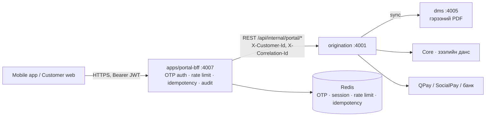

# LOS Radix — Харилцагчийн өөртөө үйлчлэх портал (Self-Service API / BFF)

Огноо: 2026-10-28 · Эзэмшигч: Altanabagana · Код: `apps/portal-bff` (port 4007), DTO: `packages/contracts/src/portal.ts`

## 1. Хамрах хүрээ, зорилго

Зээлдэгч өөрөө гар утасны апп эсвэл вэбээр: **зээлийн үлдэгдлээ шалгах, эргэн төлөлтийн хуваариа харах, гэрээгээ татах, шууд төлөлт хийх**. `apps/portal-bff` нь зөвхөн тэдгээр клиентэд зориулсан тусгай API гарц (Backend for Frontend) — өгөгдөл хадгалахгүй, бизнесийн дүрэм эзэмшихгүй, origination-ы зээлийн өгөгдөл ба төлбөр хүлээн авах үйлчилгээг харилцагчид аюулгүй, товч хэлбэрээр нээнэ.

Хамрах хүрээнээс гадуур (дараагийн алхам §10): ДАН-аар нэвтрэх, PIN/биометр, push мэдэгдэл, шинэ зээлийн хүсэлт өгөх, QPay/SocialPay-ийн жинхэнэ adapter (төлбөр тооцооны thread), origination талын endpoint-уудын хэрэгжилт.

## 2. Яагаад тусдаа `portal-bff` (gateway-д биш)

| Шалтгаан | Тайлбар |
| --- | --- |
| Итгэлийн хил | `gateway` нь ажилтны JWT/RBAC/салбарын хязгаарлалт (NFR-3); харилцагчийн хүсэлт интернетээс шууд орж ирнэ, эрсдэл, rate-limit, нэвтрэлтийн загвар огт өөр. Тусад нь байвал нэг нь алдагдсан ч нөгөөд нөлөөлөхгүй |
| Токен холилдохгүй | Харилцагчийн токен `iss=los-portal-bff`, `aud=los-portal-customer`, тусдаа нууц. Ажилтны gateway-д хүчингүй, мөн адил урвуугаараа |
| Масштаб | Харилцагчийн ачаалал (сарын эцэс, төлбөрийн өдөр) ажилтны ачаалалаас тусдаа өсдөг |
| Модуль чанар | Бусад thread-үүд `gateway`, `origination`-ыг зэрэг өөрчилнө; шинэ апп нь хуваалцсан кодыг зөвхөн `@los/contracts`-д нэг файл нэмж өөрчилнө |



CLAUDE.md §3.2 дүрмийн дагуу: portal-bff → зөвхөн `origination` (sync REST). Файлыг `origination → dms` аваад дамжуулна; `dms`-д харилцагчийн эрхийн логик үүсгэхгүй. Redis нь зөвхөн богино настай нууцлалын төлөвт (бизнесийн өгөгдөл биш), тиймээс portal-bff-д Prisma schema/миграци байхгүй.

## 3. Шаардлага

Код дотор `// PRT-FR-x.y` гэж тэмдэглэнэ. Эрэмбэ: M = заавал, S = хүсэлтэй.

| ID | Шаардлага | Эрэмбэ |
| --- | --- | --- |
| PRT-FR-1.1 | Регистр + бүртгэлтэй утас → SMS OTP (6 орон, 5 мин, 5 буруу оролдлогоор хаагдана) → access JWT | M |
| PRT-FR-1.2 | Access JWT 10 мин; refresh токен 30 хоног, ашиглах бүрд солигдоно (rotation), session дээд нас 90 хоног; хуучин refresh дахин ашиглагдвал бүх session хүчингүй | M |
| PRT-FR-1.3 | Logout тэр дор access + refresh-ийг хүчингүй болгоно | M |
| PRT-FR-1.4 | Регистр/утас бүртгэлтэй эсэхийг хариу, алдаа, мессежээр задруулахгүй | M |
| PRT-FR-2.1 | Миний зээлүүд (ACTIVE, CLOSED): үлдэгдэл үндсэн, дараагийн төлөлт, хугацаа хэтэрсэн дүн/хоног | M |
| PRT-FR-2.2 | Үлдэгдэл: үндсэн, хуримтлагдсан хүү/торгууль, хэтэрсэн (үндсэн/хүү/торгууль/хоног), өнөөдөр бүрэн хаах дүн | M |
| PRT-FR-3.1 | Эргэн төлөлтийн хуваарь: FR-7.2-ын баганууд (№, огноо, хоног, үндсэн, хүү, нийт, үлдэгдэл) + мөр бүрийн төлөв (PAID, PARTIALLY_PAID, DUE, OVERDUE, UPCOMING) ба нийлбэр | M |
| PRT-FR-4.1 | Гэрээний PDF татах (гарын үсэгтэй хувилбар байвал түүнийг); татсан үйлдэл аудитад бичигдэнэ | M |
| PRT-FR-5.1 | Төлөх боломжит дүн (дараагийн төлөлт, хугацаа хэтэрсэн, бүрэн хаах) + төлбөрийн хэрэгсэл бүрийн доод/дээд хязгаар | M |
| PRT-FR-5.2 | Төлбөр эхлүүлэх (INSTALLMENT, OVERDUE, PAYOFF, CUSTOM). CUSTOM-оос бусад төрөлд дүнг **сервер** тодорхойлно; бүрэн хаах дүнгээс илүү төлөхгүй; хэрэгслийн хязгаарт багтана | M |
| PRT-FR-5.3 | `Idempotency-Key` заавал; ижил түлхүүр+ижил агуулга → анхны хариу (`Idempotent-Replayed: true`), өөр агуулга → 422 | M |
| PRT-FR-5.4 | Төлбөрийн төлөв: PENDING → PAID / FAILED / EXPIRED / CANCELLED; PAID боловч `postedAt=null` бол Core-д тусгал хүлээгдэж байна | M |
| PRT-FR-5.5 | Төлбөрийн түүх (cursor хуудаслалт) | S |
| PRT-FR-6.1 | Аудит (FR-13.5, NFR-4): нэвтрэлт (амжилт/алдаа), refresh reuse, гэрээ татах, төлбөр үүсгэх/давтах/татгалзах. PII, токен, OTP бичигдэхгүй | M |
| PRT-NFR-1 | Объект түвшний эрх (BOLA): `:loanId`/`:paymentId` бүр хоёр давхар шалгагдана — downstream (`X-Customer-Id`) + portal-bff (өөрийн зээлийн жагсаалт). Харьяалахгүй бол 403 биш **404** | M |
| PRT-NFR-2 | Rate limit: IP глобал 300/мин; OTP хүсэлт регистр/утсаар 5/цаг, IP 20/цаг, 60с cooldown; OTP шалгалт IP 30/10мин; төлбөр үүсгэх 10/мин/харилцагч; нэвтрэлтийн алдаа IP 60/мин | M |
| PRT-NFR-3 | Нууцлал: бүх хариу `Cache-Control: no-store`; лог/аудитад регистр, утас, данс, токен, OTP бичихгүй (CLAUDE.md §6-5); регистр/утсыг Redis түлхүүрт HMAC-аар | M |
| PRT-NFR-4 | Интеграци: `INTEGRATION_MODE=mock\|real` (§3.2-7); дотоод timeout 3с, retry зөвхөн idempotent GET (§3.1); downstream хариуг zod-оор шалгана | M |
| PRT-NFR-5 | Бизнес өдөр = `Asia/Ulaanbaatar` (UTC+8); хугацаа хэтрэлт, «өнөөдөр» энэ цагаар | M |
| PRT-NFR-6 | Тохиргоо буруу бол эхлэхгүй (fail fast): production-д mock, memory store, тохируулаагүй нууц, mock OTP хориотой | M |

## 4. Харилцагчийн урсгал

```
POST /auth/otp  (регистр, утас) ──► SMS OTP илгээгдэнэ (origination.notification)
POST /auth/verify (challengeId, code) ──► accessToken (10 мин) + refreshToken
GET  /loans ──► GET /loans/:id/balance · /schedule · /contract/download
GET  /loans/:id/payment-options ──► POST /loans/:id/payments (Idempotency-Key) ──► QR / deeplink
GET  /payments/:id  (2–3 сек тутам) ──► PAID ──► GET /loans/:id/balance (шинэчлэгдсэн)
```

Төлбөрийн төлөвийг клиент polling-оор асууна; PAID болмогц үлдэгдэл, хуваарийг дахин татна. Replay хариу нь **анхны үүсгэсэн агшны** хариу (`PENDING` + checkout) — шинэ төлөвийг `GET /payments/:id`-аас авна.

## 5. API лавлагаа (`/api` угтвар)

Бүх хариу JSON, алдаа нэг загвартай: `{ "error": { "code", "message" (монгол), "correlationId", "details"? } }`. `X-Correlation-Id` толгойг клиент өгч болно (8–64 тэмдэгт), үгүй бол үүснэ; хариунд буцна.

| Method + Path | Auth | Үүрэг | Амжилт |
| --- | --- | --- | --- |
| `POST /portal/auth/otp` | — | `{registerNo, phone}` → OTP илгээнэ | 200 `{challengeId, maskedDestination, expiresInSec, resendAfterSec}` |
| `POST /portal/auth/verify` | — | `{challengeId, code}` | 200 `{tokenType, accessToken, expiresInSec, refreshToken, refreshExpiresInSec}` |
| `POST /portal/auth/refresh` | — | `{refreshToken}` (шинэ хос буцаана, хуучин нь хүчингүй) | 200 токен |
| `POST /portal/auth/logout` | Bearer | session хүчингүй | 204 |
| `GET /portal/me` | Bearer | `{displayName, phoneMasked}` | 200 |
| `GET /portal/loans` | Bearer | Миний зээлүүд | 200 `PortalLoanSummary[]` |
| `GET /portal/loans/:loanId` | Bearer | Дэлгэрэнгүй | 200 `PortalLoanDetail` |
| `GET /portal/loans/:loanId/balance` | Bearer | Үлдэгдэл, бүрэн хаах дүн | 200 `PortalLoanBalance` |
| `GET /portal/loans/:loanId/schedule` | Bearer | ЭТХ | 200 `PortalSchedule` |
| `GET /portal/loans/:loanId/contract` | Bearer | Гэрээний мэдээлэл | 200 `PortalContractInfo` |
| `GET /portal/loans/:loanId/contract/download` | Bearer | PDF (`attachment`) | 200 `application/pdf` |
| `GET /portal/loans/:loanId/payment-options` | Bearer | Төлөх дүн, хэрэгслийн хязгаар | 200 `PortalPaymentOptions` |
| `POST /portal/loans/:loanId/payments` | Bearer + `Idempotency-Key` | `{amountType, amount?, method}` | 201 `PortalPayment` |
| `GET /portal/loans/:loanId/payments?limit&cursor` | Bearer | Төлбөрийн түүх | 200 `PortalPaymentList` |
| `GET /portal/payments/:paymentId` | Bearer | Төлөв (polling) | 200 `PortalPayment` |
| `GET /health` | — | Амьд эсэх | 200 |

Алдааны код → HTTP: `INVALID_REQUEST` 400 · `UNAUTHENTICATED` 401 · `LOAN_NOT_FOUND`/`PAYMENT_NOT_FOUND`/`CONTRACT_NOT_AVAILABLE`/`NOT_FOUND` 404 · `LOAN_NOT_PAYABLE`/`NO_OVERDUE`/`REQUEST_IN_PROGRESS` 409 · `AMOUNT_OUT_OF_RANGE`/`METHOD_NOT_AVAILABLE`/`IDEMPOTENCY_KEY_REUSED` 422 · `OTP_INVALID`/`OTP_EXPIRED`/`IDEMPOTENCY_KEY_REQUIRED` 400 · `RATE_LIMITED`/`OTP_ATTEMPTS_EXCEEDED` 429 (+`Retry-After`) · `DOWNSTREAM_INVALID_RESPONSE` 502 · `DOWNSTREAM_UNAVAILABLE` 503 · `INTERNAL` 500. Мессеж бүр `apps/portal-bff/src/common/error-catalog.ts`-д.

Мөнгө `numeric(18,2)` → `number` (2 орон); хувь нь нэрэндээ нэгжтэй (`annualInterestRatePercent: 23.99` = 23.99%); огноо `YYYY-MM-DD`, цаг ISO-8601.

## 6. Origination-д хэрэгжүүлэх дотоод гэрээ (`/api/internal/portal/*`)

portal-bff `INTEGRATION_MODE=real` үед эдгээрийг дуудна. **Origination талын хэрэгжилт энэ PR-д ороогүй** (origination-д одоогоор хүснэгт/модуль байхгүй — Модуль 0, 7, 10, 11 хүлээгдэж байна). Лавлах хэрэгжилт: `apps/portal-bff/src/testing/fake-origination.ts` (MockLedger дээр, жинхэнэ HTTP-ээр real adapter-уудыг тест хийдэг).

Бүх дуудлагад толгой: `X-Correlation-Id`, `X-Actor-Type: CUSTOMER` (нэвтрэхээс өмнөх дуудлагад `PORTAL_ANONYMOUS`), `X-Customer-Id`, `X-Roles: CUSTOMER`. Ажилтны `X-User-Id/X-Branch-Id` байхгүй — origination эдгээр маршрутад **ажилтны guard-ыг хэрэглэж болохгүй**, тусдаа guard (`X-Actor-Type=CUSTOMER` шаардана). Дотоод сүлжээ/mTLS нь CLAUDE.md §3.2-9-тэй адил; portal-bff-ээс өөр эх үүсвэр эдгээр маршрутад хандаж болохгүй (network policy).

| Endpoint | Хариу (zod: `@los/contracts`) | Дүрэм |
| --- | --- | --- |
| `POST /customers/lookup` `{registerNo, phone}` | 200 `PortalCustomerLookup` / 404 | Регистр+бүртгэлтэй утас таарсан, ≥1 зээлтэй (ACTIVE/CLOSED/MIGRATED) харилцагч. Таарахгүй бол 404 (алдаа биш) |
| `GET /customers/me` | `PortalProfile` | Нэрийг богиносгосон (`Б. Болд`), утас нуусан |
| `POST /otp` `{code, ttlSec}` | 202 | Харилцагчийн **бүртгэлтэй** утас руу SMS (notification adapter). Кодыг лог/аудитад бичихгүй |
| `GET /loans` | `PortalLoanSummary[]` | `X-Customer-Id`-ийн зээлдэгч (PRIMARY) болсон зээлүүд. ACTIVE + CLOSED (MIGRATED → ACTIVE/CLOSED-д буулгана) |
| `GET /loans/:id` · `/balance` · `/schedule` | `PortalLoanDetail` · `PortalLoanBalance` · `PortalSchedule` | Харьяалахгүй бол **404**. Үлдэгдэл, төлсөн дүн, торгууль — Core-оос; `payoff` өнөөдрийн дүн |
| `GET /loans/:id/contract` | `PortalContractInfo` / 404 `CONTRACT_NOT_AVAILABLE` | `contract.signed_file_id` байвал `signed=true` |
| `GET /loans/:id/contract/content` | `application/pdf` stream | origination `dms`-ээс авч дамжуулна; `Content-Type: application/pdf` заавал |
| `GET /loans/:id/payment-methods` | `PortalPaymentMethodLimit[]` | Идэвхтэй хэрэгсэл + доод/дээд (тохиргооноос, hardcode биш — CLAUDE.md §3.2-8) |
| `POST /loans/:id/payments` + `Idempotency-Key` | 201 `PortalPayment` | Body = `PortalCreatePaymentCommand` (дүн тодорхойлогдсон). **(customerId, key)-ээр давхардлыг хаана**; ижил түлхүүр+өөр body → 422 `IDEMPOTENCY_KEY_REUSED`. Дүнг Core-той дахин тулгана (`LOAN_NOT_PAYABLE`, `AMOUNT_OUT_OF_RANGE`, `METHOD_NOT_AVAILABLE`) |
| `GET /loans/:id/payments?limit&cursor` | `PortalPaymentList` | Шинэ нь түрүүнд; cursor нь тогтвортой |
| `GET /payments/:id` | `PortalPayment` | Харьяалахгүй бол 404 `PAYMENT_NOT_FOUND`. Шаардлагатай бол провайдераас шалгаж төлөв шинэчилнэ |

Төлбөрийн хариуцлага (origination): төлбөрийн бичлэг, провайдерын нэхэмжлэх, callback/webhook-ийн баталгаажуулалт, Core руу тусгах (`postedAt`), давхар тусгалаас сэргийлэх. Провайдерын webhook **portal-bff-д биш origination `integrations/payment/`-д** төгсөнө. Төлбөр баталгаажихад origination `RepaymentReceived`-тэй төстэй event-ийг outbox-оор нийтэлж (dwh-sync, ERP/Core sync) §3.2-4-ийг мөрдөнө — event-ийн нэр/схемийг төлбөр, ERP thread-үүдтэй тохируулна.

## 7. Тохиргоо (env)

| Хувьсагч | Анхдагч | Тайлбар |
| --- | --- | --- |
| `NODE_ENV` | `development` | `production`-д доорх нөхцөл заавал |
| `PORTAL_BFF_PORT` | `4007` | |
| `INTEGRATION_MODE` | `mock` | `mock` \| `real`. Production-д зөвхөн `real` |
| `ORIGINATION_URL` | `http://localhost:4001` | `real` үед |
| `PORTAL_INTERNAL_TIMEOUT_MS` | `3000` | Дотоод дуудлагын timeout (§3.1) |
| `PORTAL_MAX_CONTRACT_BYTES` | `26214400` | Гэрээний PDF-ийн дээд хэмжээ (25 MiB); давбал 502 |
| `PORTAL_STORE` / `REDIS_URL` | `memory` / — | `REDIS_URL` өгвөл `redis`. Production-д redis заавал |
| `PORTAL_JWT_SECRET`, `PORTAL_HASH_SECRET` | dev утга | ≥32 тэмдэгт, бие биенээсээ ялгаатай. Production-д заавал, ажилтны `JWT_SECRET`-тэй давхцуулахгүй |
| `PORTAL_ACCESS_TTL_SEC` / `PORTAL_REFRESH_TTL_SEC` | `600` / `2592000` | |
| `PORTAL_OTP_TTL_SEC`, `PORTAL_OTP_RESEND_SEC`, `PORTAL_OTP_MAX_ATTEMPTS` | `300`, `60`, `5` | |
| `PORTAL_OTP_REQUESTS_PER_HOUR`, `…_PER_IP` | `5`, `20` | OTP хүсэлтийн хязгаар |
| `PORTAL_MOCK_OTP_CODE` | — | Зөвхөн dev: тогтмол 6 оронтой код. Production-д хориотой |
| `PORTAL_CORS_ORIGINS` | хоосон | таслалаар; `*` хориотой; production-д https. Хоосон = CORS унтраалттай (мобайл апп-д хэрэггүй) |
| `PORTAL_TRUST_PROXY` | `0` | LB/ingress ард хэдэн hop. Буруу бол IP rate-limit хуурамч болно |
| `PORTAL_TIMEZONE` | `Asia/Ulaanbaatar` | |
| `PORTAL_MOCK_PAYMENT_CONFIRM_MS` | `3000` | mock төлбөр хэдэн мс-д PAID болох |

## 8. Аюулгүй байдлын загвар

| Эрсдэл | Хяналт |
| --- | --- |
| Өөр хүний зээл/төлбөр харах (BOLA/IDOR) | downstream `X-Customer-Id`-аар хязгаарлана **ба** portal-bff `:loanId`-г өөрийн жагсаалттай тулгана; зөрсөн хариуг (өөр loanId) 502-оор хаана; харьяалахгүй → 404 |
| OTP таах / brute force | HMAC-аар хадгална, нэг удаа, 5 оролдлого (атомар `INCR`), IP+регистр+утсаар rate limit, 60с cooldown, `getdel`-ээр нэг удаагийн хэрэглээ |
| Хэрэглэгч байгаа эсэхийг тандах | Decoy challenge: ижил хариу, `OTP_INVALID` ижил. (Анхаар: SMS илгээх хугацааны зөрүү жижиг; нэмэлт хамгаалалт §10) |
| Токен хулгай | 10 мин access; refresh rotation + reuse detection (бүх session хүчингүй); server-side session (logout тэр дор); HS256 тогтмол (alg-confusion үгүй), ажилтны токентой холилдохгүй |
| Давхар төлбөр | `Idempotency-Key` (Redis, customer-scoped, 24ц) + downstream-д дамжуулж давхар хаалт; алдаа гарвал түлхүүр суллагдана |
| Дүн хуурах | Сервер дүнг Core-ийн үлдэгдлээс тодорхойлно; CUSTOM ≤ бүрэн хаах дүн; хэрэгслийн хязгаар |
| Downstream-ээс мэдээлэл алдагдах | Хариуг zod-оор шалгаж, гэрээнд үгүй талбарыг хасна; үл мэдэх бизнес алдааны код харилцагчид гарахгүй |
| SSRF / redirect | Зөвхөн тохируулсан `ORIGINATION_URL`; `redirect: 'error'`; ID-г regexp-ээр хязгаарласан + `encodeURIComponent` |
| Лог дахь PII | `JsonLogger`/аудит зөвхөн ID, код, дүн; регистр, утас, токен, OTP бичихгүй (тестээр баталгаажсан) |
| Кэшлэгдэх | `Cache-Control: no-store`; `helmet` толгойнууд |
| Буруу тохиргоо | `loadConfig` production-д mock/memory/нууц дутуу бол эхлэхгүй |

## 9. Ажиллуулах (mock горим)

```
pnpm install
pnpm --filter @los/portal-bff dev          # http://localhost:4007/api/health
```

Mock-д Redis, origination шаардлагагүй. Демо нэвтрэлт (`PORTAL_MOCK_OTP_CODE=123456` тохируулбал код тогтмол):

| Харилцагч | Регистр | Утас | Зээл |
| --- | --- | --- | --- |
| Б. Болд | `УБ90010112` | `99112233` | `loan_demo_001` (30,000,000₮, 23.99%, 36 сар, 11 төлсөн), `loan_demo_002` (хаагдсан) |
| С. Сараа | `УА85050505` | `88112233` | `loan_demo_003` (3 сар хэтэрсэн) |

```
curl -s localhost:4007/api/portal/auth/otp -H 'content-type: application/json' -d '{"registerNo":"УБ90010112","phone":"99112233"}'
curl -s localhost:4007/api/portal/auth/verify -H 'content-type: application/json' -d '{"challengeId":"…","code":"123456"}'
```

Mock төлбөр нэг ledger дээр ажиллана: төлбөр PAID болмогц үлдэгдэл, хуваарийн төлөв, түүх өөрчлөгдөнө (хугацаа хэтэрсэн хэсгээс эхлэн хүү→үндсэн дарааллаар хаана; PAYOFF зээлийг хааж ирээдүйн хүүг уучилна). Торгууль загварчлаагүй.

Тест: `pnpm --filter @los/portal-bff test` (112 тест; `TEST_REDIS_URL=redis://… ` өгвөл Redis хэрэгжүүлэлт мөн гэрээний тестээр шалгагдана). `INTEGRATION_MODE=real` e2e нь `FakeOrigination`-тэй жинхэнэ HTTP-ээр ажиллана.

## 10. Нээлттэй асуудал, дараагийн алхам

1. **Origination талын endpoint-ууд** (§6) — Модуль 0 (хүснэгт), 7 (ЭТХ), 10–11 (гэрээ, олголт, Core) дараа. Тэр хүртэл portal-bff mock-оор frontend хөгжүүлэлтэд бэлэн.
2. **SMS OTP** — `origination.notification`-ий SMS adapter (мэдэгдлийн thread). Одоо `POST /otp` дотоод гэрээгээр.
3. **Төлбөрийн adapter** (QPay, SocialPay, банкны данс) — төлбөр тооцооны thread-ийн `integrations/payment/`; webhook-ийн баталгаажуулалт, Core-д тусгал, `RepaymentReceived` event.
4. **Аудитыг хадгалах** — одоо `audit:true` JSON лог; `origination.audit_log` (дотоод API) эсвэл portal schema руу бичдэг sink нэмэх.
5. **OpenAPI** — DTO нь zod; `@los/contracts`-аас OpenAPI үүсгэх (CLAUDE.md §2.2) нэгдсэн алхамд.
6. **Нэвтрэлтийн нэмэлт хүчин зүйл** — PIN/биометр, ДАН (ХУР/ДАН интеграцитай), төхөөрөмж бүртгэл, идэвхтэй session-ий жагсаалт.
7. **Мэдэгдэл** — төлбөрийн сануулга, баталгаажилт push/SMS (мэдэгдлийн thread).
8. **Вэб портал UI** — `apps/web` дээр `/portal/*` хуудас (`@los/ui`), `NEXT_PUBLIC_PORTAL_URL`.
9. **Тоон дээр** — торгуулийн томьёо, ханш (USD), хэсэгчилсэн төлөлтийн дараалал (`торгууль → хүү → үндсэн`) Core-ийн бодит дүрмээр.
